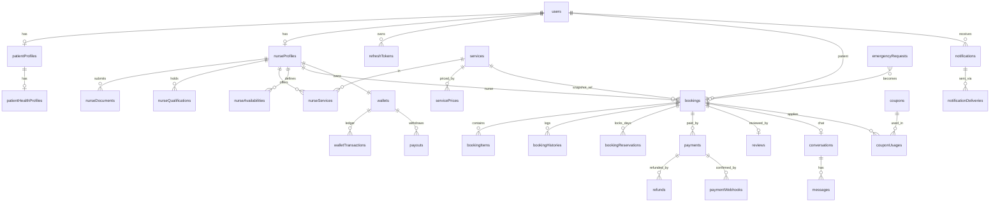
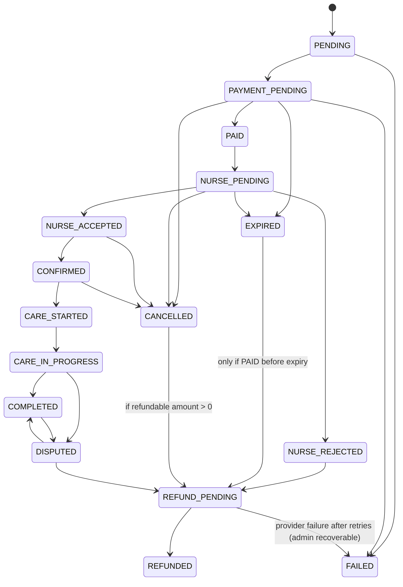

# Home Care Marketplace Backend: Architecture & Design (for review)

Status: **v2, approved with final decisions (see "Final Decisions" below). Phase 1 complete; Phases 1-3 implemented (see "Phase 2 as built", "Phase 2.1 hardening", "Phase 3 as built" and "Phase 3 hardening").**

## Final Decisions (supersede anything below that conflicts)

| #   | Decision                                                                                                                                                                                                                                                                                                                                                                                                                                          |
| --- | ------------------------------------------------------------------------------------------------------------------------------------------------------------------------------------------------------------------------------------------------------------------------------------------------------------------------------------------------------------------------------------------------------------------------------------------------- |
| 1   | **Time-range bookings.** `startDateTime`/`endDateTime` (UTC instants) are the source of truth. A nurse may have many bookings per day if ranges do not overlap. Daily-care services only define a default time window; the engine stays range-based.                                                                                                                                                                                              |
| 2   | **Platform-funded coupons.** Nurse earnings and commission are computed from the **gross (pre-discount)** amount. Booking stores a `financialSnapshot`: `grossMinor, discountMinor, patientPaidMinor, platformFundedDiscountMinor, commissionMinor, nurseEarningMinor, paymentProcessingFeeMinor, platformNetRevenueMinor`. Invariant: `commission + nurseEarning == gross`; `platformNet = commission − platformFundedDiscount − processingFee`. |
| 3   | **Cancellation outcome is policy-driven** (`refundPolicy` in PlatformSettings, snapshotted on booking). Each tier: `{minHoursBeforeStart, refundPercent, nurseCompensationPercent}`. Default: ≥48h 100/0, 24–48h 50/50 of the non-refunded part, <24h 0/100. The booking records `cancellationOutcome {tier, refundMinor, nurseKeptMinor, platformKeptMinor}`.                                                                                    |
| 4   | Both `CARE_STARTED` and `CARE_IN_PROGRESS` are kept: `CONFIRMED → CARE_STARTED → CARE_IN_PROGRESS → COMPLETED`.                                                                                                                                                                                                                                                                                                                                   |
| 5   | `RELEASE` ledger type approved (transactional + idempotent).                                                                                                                                                                                                                                                                                                                                                                                      |
| 6   | **Express 5** + TypeScript.                                                                                                                                                                                                                                                                                                                                                                                                                       |
| 7   | **JWT RS256**; PEM keys from env (`JWT_PRIVATE_KEY`/`JWT_PUBLIC_KEY`, base64 PEM, or `*_FILE` paths for secret mounts). Never in the repo. Refresh tokens: opaque random, hashed, rotation + family reuse detection.                                                                                                                                                                                                                              |
| 8   | **`PayoutProvider`** abstraction; DB stores only provider token/reference + non-sensitive metadata (`payoutMethods` fields: `provider, providerRef, last4?, bankName?`). No raw IBAN/card data.                                                                                                                                                                                                                                                   |
| 9   | Platform timezone **Asia/Dubai** (default), configurable in `PlatformSettings` (`platform.timezone`) and env fallback. All business-day logic uses `luxon` zone-aware helpers, never server-local time. Instants stored in UTC.                                                                                                                                                                                                                   |
| 10  | **Auto-complete** at `endDateTime + graceMinutes` (default 120, configurable). Skipped for DISPUTED, CANCELLED, REFUND_PENDING, REFUNDED, COMPLETED, EXPIRED, FAILED, or any booking with open refund/dispute. Implemented as a guarded state transition, so it is idempotent.                                                                                                                                                                    |
| 11  | MongoDB runs as a **replica set** in all environments (Docker `rs0` with keyfile-less dev init; test uses `MongoMemoryReplSet`).                                                                                                                                                                                                                                                                                                                  |
| 12  | **Slot-bucket reservations** (see revised F): reservations protect the _time range_, not a day.                                                                                                                                                                                                                                                                                                                                                   |
| 13  | Defense-in-depth kept; Redis best-effort; clean `409 BOOKING_CONFLICT`.                                                                                                                                                                                                                                                                                                                                                                           |
| 14  | Integer minor units, bps commissions, transactional + idempotent finance.                                                                                                                                                                                                                                                                                                                                                                         |

### Revised reservation design (replaces the per-day design in B/C/E/F)

MongoDB cannot put a unique index on a _range_, so a range is decomposed into fixed **slots** and the unique index is placed on the slots:

```
bookingReservations: { nurseId, slotStart (UTC Date, aligned to slotMinutes), bookingId, state: HELD|CONFIRMED, expiresAt? }
unique index: { nurseId: 1, slotStart: 1 }
```

- `slotMinutes` = `booking.slotMinutes` in PlatformSettings (default **15**). Booking start/end must be aligned to the slot grid (validated server-side). A booking `[start,end)` produces slots `start, start+15m, …, end−15m`.
- Two bookings overlap **iff** they share at least one slot, so the unique index is _exactly_ the overlap rule: 08:00–12:00 and 14:00–18:00 share no slot → both succeed; 08:00–12:00 and 11:45–13:00 share the 11:45 slot → E11000 → `409 BOOKING_CONFLICT`. Adjacent bookings (12:00 start after 12:00 end) do not conflict. An optional `bufferMinutes` (default 0) extends the held slots after the end (travel time).
- Slot count is bounded (`maxBookingHours`, default 24×14 → ≤1344 slots; inserted with one `insertMany({ordered:true})` in the transaction). Long multi-day care therefore costs more documents, which is the accepted trade-off for a hard guarantee.
- Expiry/cleanup: HELD slots carry `expiresAt`. The state machine deletes slots in the same transaction that expires/cancels/rejects a booking. A sweeper job also deletes HELD slots whose booking is no longer blocking, so a crashed process cannot leave orphans. Correctness never depends on a TTL index, because a TTL index lags up to 60s and is not transactional.
- Layers (unchanged order): Mongo transaction → per-nurse serialization (`$inc bookingSeq` on nurseProfile) → slot insert (unique index) → overlap query (with message/diagnostics) → Redis lock (best-effort).

_Where the sections below say `startDate/endDate`, read `startDateTime/endDateTime`; where they say "per day / day bucket", read "per slot"._

## Phase 2 as built (supersedes the earlier sketches where they differ)

**Modules added:** `settings`, `services` (catalog + nurse offers), `pricing` (rate card, holidays, quotes), `availability`, `matching`, `bookings` (models, state machine, reservations, expiry), `nurse-search`.

**Booking time model.** `startDateTime`/`endDateTime` are UTC instants. Reservations are one document per `booking.slotMinutes` (default 15) slot with a unique `{nurseId, slotStart}` index. Two bookings can coexist iff they share no slot, so several bookings per nurse per day are fine and overlap is impossible at the database level. There is no `{nurseId, day}` uniqueness anywhere.

**Create-booking defense in depth (all inside one MongoDB transaction):** best-effort Redis lock (skipped on failure/timeout) -> `$inc bookingSeq` on the nurse document (serialises concurrent transactions for that nurse; the loser gets a WriteConflict and the transaction retries) -> lapsed holds of that nurse are expired in-transaction -> overlap query on live bookings -> booking + items + history -> slot `insertMany` (unique index = final arbiter, E11000 -> `409 BOOKING_CONFLICT`) -> `PENDING -> PAYMENT_PENDING`.

**Quote -> booking.** `POST /bookings/quote` returns an itemised integer-fils price and an RS256-signed `quoteToken` (audience `care-quote`, TTL `booking.quoteTtlSeconds`) bound to patient, service, nurse, time range, payable total and a `pricingVersion` fingerprint. `POST /bookings` verifies the token, re-prices on the server and rejects any difference (`QUOTE_MISMATCH`, `QUOTE_EXPIRED`, `INVALID_QUOTE`). The body is strict: client-sent amounts are rejected.

**Pricing.** `servicePrices` is an effective-dated, versioned rate card (`HOURLY`, `DAILY`, `WEEKEND_SURCHARGE`, `HOLIDAY_SURCHARGE` in bps, fixed `FEE`s), optional per-nurse overrides on `nurseServices`, holidays in `holidays`, weekend days and commission in `platformSettings`. HOURLY is prorated per minute per local day (half-up integer rounding); DAILY bills every started 24h block. Holiday beats weekend (no stacking). Commission and nurse earnings are computed on GROSS (platform absorbs discounts); `commission + nurse == gross` exactly.

**Availability.** Rules (`WEEKLY`, `DATE` override, `BLOCKED` vacation/holiday/blocked ranges) in the platform timezone; precedence BLOCKED > DATE > WEEKLY; a request must lie fully inside one working window on every local day it touches. Existing bookings are never cancelled by availability edits.

**State machine.** Declarative table in `booking.states.ts` + guards/side effects in `booking.statemachine.ts`. The Booking model rejects any write to `status`/`version` without the `transitionAuthorized` option (only the state machine passes it) and rejects any write to the snapshot/time/identity fields. History, items and audit logs are append-only.

**Expiry & lifecycle sweeps (no timers).** `BookingService.expireDue`, `autoCompleteDue`, `cleanupOrphanReservations` are idempotent service methods; Phase 4 schedules them with BullMQ.

**Search.** `$geoNear` + indexed filters in MongoDB; sorts `rating|price|experience|distance` and pagination run in MongoDB. `relevance` and availability filtering need application logic and run over at most 300 pre-filtered candidates (`truncated` flag).

**Cancellation (Phase 2 rule).** Patients may cancel only unpaid bookings; paid-booking cancellation is refused with `CANCELLATION_NOT_ALLOWED` until Phase 3 provides the refund flow.

## Phase 2.1 hardening (approved decisions, implemented)

### Refund workflow (business state only; no provider call until Phase 3)

| Trigger                                                                              | Path                                                             | Refund                                                                                                                                                          |
| ------------------------------------------------------------------------------------ | ---------------------------------------------------------------- | --------------------------------------------------------------------------------------------------------------------------------------------------------------- |
| Patient cancels, unpaid (`PENDING`/`PAYMENT_PENDING`)                                | `CANCELLED`                                                      | none                                                                                                                                                            |
| Patient cancels, paid and not started (`NURSE_PENDING`/`NURSE_ACCEPTED`/`CONFIRMED`) | `CANCELLED -> REFUND_PENDING`                                    | percent from the booking's **snapshotted** `refundPolicySnapshot`: 48h+ 100%, 24-48h 50%, under 24h 0% (a 0% outcome stays `CANCELLED`, `refund.status = NONE`) |
| Nurse rejects a paid booking                                                         | `NURSE_REJECTED -> REFUND_PENDING`                               | always 100%                                                                                                                                                     |
| Nurse does not respond (paid)                                                        | `EXPIRED -> REFUND_PENDING`                                      | always 100%                                                                                                                                                     |
| Unpaid hold lapses                                                                   | `EXPIRED`                                                        | none                                                                                                                                                            |
| Admin cancels                                                                        | `CANCELLED -> REFUND_PENDING`                                    | policy tier, or an explicit `refundPercent` override (audit-logged)                                                                                             |
| Admin resolves a dispute                                                             | `DISPUTED -> REFUND_PENDING` or `COMPLETED`                      | 1-100% or none (audit-logged)                                                                                                                                   |
| Provider confirms the refund (Phase 3)                                               | `REFUND_PENDING -> REFUNDED` via `BookingService.completeRefund` | exactly once; replays return `changed:false`                                                                                                                    |

Each hop is a separate state-machine transition with its own history row, and both hops of a pair commit in one MongoDB transaction. The booking stores `cancellationOutcome` (hours before start, tier, refund / nurse-compensation / platform-kept amounts that always sum to the amount paid) and `refund {status, reason, percent, amountMinor, requestedAt, completedAt, providerRefundId}`. For tiered cancellations the remainder after the refund is split by the tier's `nurseCompensationPercent` (default: 24-48h half to the nurse, under 24h all to the nurse). An admin override pays the nurse no compensation (adjustable by ledger adjustment in Phase 3). `reconcileRefundRequests` repairs any paid terminal booking that lacks a refund obligation. Policy is a PlatformSetting (`refund.policy`) copied onto each booking at creation, so later policy edits never change existing bookings.

### Authorization of cancellation

Patients cancel only their own bookings; nurses have no cancellation transition at all (state table + 403 on the route); admins cancel/resolve through `/admin/bookings/:id/cancel|resolve` (`admin:bookings:manage`), always audit-logged. Cancellation never bypasses the state machine: `Booking.status` cannot be written by anything else.

### No-show policy

A `CONFIRMED` booking whose whole window has passed (`endDateTime + booking.noShowGraceMinutes`, default 30) without a care-start event is moved by `BookingService.flagNoShows` to **`DISPUTED`** with reason `NO_SHOW_SUSPECTED`. **No automatic financial settlement happens**: no refund, no completion, no earnings release, no auto-complete, no expiry. Only an admin decides (`POST /admin/bookings/:id/resolve`: refund 1-100% -> `REFUND_PENDING`, or `COMPLETE` with no refund). Phase 3 must treat `DISPUTED` as "earnings frozen".

### Booking idempotency (`Idempotency-Key`, required on `POST /bookings`)

MongoDB collection `idempotencyKeys`, unique `{scope, userId, key}`, TTL 24h. The first request inserts an `IN_PROGRESS` record (the unique index decides the owner), and the record is marked `COMPLETED` with the response **inside the same transaction that creates the booking**, so a booking exists iff its key is completed. Same key + same payload replays the stored response (`Idempotent-Replayed: true`); same key + different payload is `422 IDEMPOTENCY_KEY_REUSED`; a concurrent duplicate waits for the original (`409 IDEMPOTENCY_IN_PROGRESS` after the wait window); a crashed owner (lock lapsed, no booking) can be taken over; failed requests are not cached. Keys are per user, so another patient can neither collide with nor read someone else's record. Redis is not used. This sits in front of, and does not replace, the slot-reservation concurrency protections.

### Payment confirmation (Phase 3 contract)

The verified payment webhook must run ONE MongoDB transaction that:

1. records the webhook event (unique `provider+eventId`) and finalises the payment (`PENDING -> PAID`, guarded);
2. calls `BookingService.markPaid(bookingId, { paymentId, session })` (`PAYMENT_PENDING -> PAID -> NURSE_PENDING`, reservations `HELD -> CONFIRMED`, nurse response deadline = min(now + response window, start)). Replaying the same `paymentId` is a no-op; an expired hold can never be paid (the booking is expired and the caller gets `409 BOOKING_EXPIRED`, so Phase 3 must refund such a late payment);
3. credits the nurse wallet **pendingBalance** by `BookingService.pendingEarningFor(booking).amountMinor` (= `financialSnapshot.nurseEarningMinor`, never recomputed from current prices or commission) and writes the ledger row with idempotency key `wallet:pending-earning:<bookingId>` (balance change + ledger row in the same transaction);
4. queues notifications/events after commit.

Payment finalisation lives in exactly one service (not in controllers or providers); provider adapters only verify and translate events.

### Financial state protections (tested)

`PAID` twice, `REFUNDED` twice, rejecting twice, accepting an expired booking, completing a cancelled/refunded booking, starting an unpaid or expired booking and all other off-table moves raise `InvalidBookingStateError` (`422 INVALID_BOOKING_STATE`). `REFUND_PENDING` requires a recorded payment, and `REFUNDED` requires a pending refund.

## Phase 3 as built: payments, webhooks, commission, wallet ledger, refunds, payouts

**Modules added:** `payments`, `wallets`, `refunds`, `payouts`, `alerts`, `finance` (webhook pipeline, reconciliation, sweeps, admin finance API), `idempotency` (Phase 2.1), provider adapters in `src/providers/payment`. Booking transitions reach finance only through `booking.hooks.ts` (no module cycle); `registerFinancialHooks()` is called by `createApp()`.

### Final decisions implemented

| #   | Decision                                               | Implementation                                                                                                                                                                                                                                                                                                                                                                                                                                                                                                                                                                                                                               |
| --- | ------------------------------------------------------ | -------------------------------------------------------------------------------------------------------------------------------------------------------------------------------------------------------------------------------------------------------------------------------------------------------------------------------------------------------------------------------------------------------------------------------------------------------------------------------------------------------------------------------------------------------------------------------------------------------------------------------------------- |
| 1   | `DISPUTED` freezes nurse earnings                      | Release only considers `COMPLETED` (+ the retained share of `CANCELLED`/`REFUNDED`); `DISPUTED`, `FAILED`, `REFUND_PENDING` are never released. Resolution: `COMPLETE` releases after the normal delay (counted from resolution), `REFUND` reverses via the ledger.                                                                                                                                                                                                                                                                                                                                                                          |
| 2   | `REFUND_PENDING` reverses pending earnings immediately | `onRefundPending` hook, same transaction as the transition: `REVERSAL` ledger row(s) + refund obligation. Provider success keeps the reversal final; a permanently failed refund adds a compensating `ADJUSTMENT` row that restores the earnings.                                                                                                                                                                                                                                                                                                                                                                                            |
| 3   | Partial cancellation refunds                           | `patientRefund + nurseShare + platformShare = patientPaid`. The retained amount is allocated with the booking's OWN snapshot: `nurseShare = nurseEarning x retained / paid` (capped at retained), `platformShare = retained - nurseShare`. Policy `nurseCompensationPercent` is no longer used for the split (kept in stored policies for compatibility).                                                                                                                                                                                                                                                                                    |
| 4   | Late payment                                           | Never revives the booking. Payment is recorded `PAID` + `settlement=LATE_REFUND`, a 100% refund with reason `BOOKING_EXPIRED_BEFORE_PAYMENT_CONFIRMATION` is created (a second payment for an already-paid booking is refunded as `DUPLICATE_PAYMENT`), no earnings are credited.                                                                                                                                                                                                                                                                                                                                                            |
| 5   | Refund provider failures                               | Refund states `PENDING -> PROCESSING -> SUCCEEDED`; a failure leaves it `PENDING` with `attempts`, `failureCount`, `lastError`, `nextRetryAt` (exponential backoff 60s, 120s, 240s ... capped 6h), the provider idempotency key is constant (`refund-<id>`), an admin alert is raised after `refund.alertAfterAttempts`, and after `refund.maxAttempts` (or a non-retryable error) the refund goes `FAILED`, the booking uses the existing `FAILED` state, earnings are restored and a CRITICAL alert is raised. Only a verified provider success produces `REFUNDED`. An admin can re-open a `FAILED` refund (same record, generation + 1). |
| 6   | No-show                                                | Unchanged: `CONFIRMED -> DISPUTED` after `endDateTime + booking.noShowGraceMinutes` (default 30). Nothing is refunded or released by the timer.                                                                                                                                                                                                                                                                                                                                                                                                                                                                                              |

### Payment architecture

- `PaymentProvider` (createPayment, verifyPayment, cancelPayment, refundPayment, createPayout, verifyWebhook) and `PayoutProvider`; `MockPaymentProvider` (throws in production, signs/verifies exactly like a real provider, scripted failures for tests) and `StripePaymentProvider` (REST skeleton, unit-tested with an injected fetch, NOT exercised against live Stripe). Selected by `PAYMENT_PROVIDER`; secrets only from env. Business code never imports a concrete provider.
- Payment statuses: `PENDING -> PROCESSING -> PAID`, `FAILED`, `CANCELLED`, then `PARTIALLY_REFUNDED` / `REFUNDED`. `PAID` is set only by a verified webhook. The amount is copied from the booking snapshot; the provider client secret is returned once and never stored. At most one open payment per booking (partial unique index).

### Webhook flow (`POST /api/v1/payments/webhook`, raw body)

1. Verify the provider signature (HMAC over `timestamp.rawBody`, 5-minute tolerance, constant-time compare). Invalid => `400`, nothing stored.
2. Hash the payload and INSERT the inbox row (`paymentWebhooks`, unique `{provider, eventId}`) first. A duplicate of a processed event returns `DUPLICATE`; a different payload under a known id is ignored and alerted; a crashed/failed delivery is re-claimed under a lease; a live concurrent delivery gets `409`.
3. One MongoDB transaction applies the event and marks the inbox row `PROCESSED`/`IGNORED`: payment `PAID` (guarded), `BookingService.confirmPayment` -> `markPaid` (`PAYMENT_PENDING -> PAID -> NURSE_PENDING`), nurse `pendingBalance += financialSnapshot.nurseEarningMinor` with ledger row `EARNING` (key `wallet:pending-earning:<bookingId>`), or the late-payment refund obligation. Any error rolls everything back, marks the row `FAILED` and returns `500` so the provider redelivers.
4. A confirmed amount/currency that differs from the payment is never applied (payment `FAILED`, CRITICAL alert).

### Wallet ledger

`wallets` (available, pending, totalEarned, totalWithdrawn) and append-only `walletTransactions` (type, bucket, signed amount, balanceBefore/After, earnedDelta, withdrawnDelta, reference, unique `idempotencyKey`). `WalletService.apply` is the only balance mutator: idempotency check, conditional `$inc` (a debit can never take a balance below zero), ledger insert, all in the caller's transaction; concurrent operations serialise on the wallet document. Types: `EARNING`, `RELEASE` (two rows), `REVERSAL`, `ADJUSTMENT`, `PAYOUT`, `PAYOUT_SETTLED`, `PAYOUT_REVERSAL` (+ reserved `REFUND`, `COMMISSION`). `RELEASE` runs after `wallet.releaseDelayHours` (48) from completion (or from refund completion / cancellation for the retained share). Money already withdrawn cannot be reversed: balances never go negative and a CRITICAL `NURSE_EARNINGS_SHORTFALL` alert is raised.

### Commission

Rules in `commissions` (GLOBAL / SERVICE / NURSE; PERCENTAGE in integer basis points or FIXED in fils; effective-dated, versioned, never edited in place). Resolution: NURSE > SERVICE > GLOBAL > service `commissionBps` > `commission.defaultBps`. The applied terms are snapshotted on each booking (`commissionSnapshot`, `financialSnapshot`) and are part of the quote fingerprint. Commission and nurse earnings are computed from GROSS, so a platform-funded discount never reduces nurse earnings; `commission + nurse == gross` exactly.

### Payouts

`payoutMethods` store only the provider token + non-sensitive metadata (raw IBAN-like input is rejected). `POST /payouts` (required `Idempotency-Key`) debits `availableBalance` (ledger `PAYOUT`) and creates the `PENDING` payout in one transaction; one open payout per nurse. The sweep moves it `PENDING -> PROCESSING -> PAID` (ledger `PAYOUT_SETTLED`, `totalWithdrawn`), retries with backoff, and on final failure `FAILED` returns the funds with `PAYOUT_REVERSAL` + CRITICAL alert. Only unprocessed payouts can be cancelled.

### Reconciliation (read-only) and operations

`GET /admin/reconciliation` checks: wallet balances vs ledger, ledger row arithmetic, pending balance vs the state of each booking, payments vs bookings, refunds vs payments, pending-refund obligations, commission/allocation arithmetic from snapshots, payouts vs ledger. It never modifies data; the one repair (`POST /admin/reconciliation/repair/refund-obligations`) is explicit and audit-logged. `POST /admin/finance/process-due` (and the optional `INLINE_JOBS=true` timer) run every time-driven sweep once; Phase 4 replaces this with BullMQ workers and a scheduler (see "Phase 4").

### Idempotency map

webhook events (`{provider,eventId}` + guarded updates), payment confirmation (replay of the same payment id is a no-op), booking creation and payout requests (`Idempotency-Key` + MongoDB records), refunds (unique key per booking, one active refund per payment, constant provider key), wallet operations (unique ledger key), release (`release:<booking>:*`), reversal (`reversal:<booking>:g<n>:*`), payout steps (`payout:<id>:request|settled|reversal`), admin adjustments (header key).

---

Stack: Node.js, TypeScript (strict), Express, MongoDB + Mongoose, Redis, BullMQ, Socket.IO, JWT, Swagger, Jest/Supertest, Docker.

---

## A. Architecture

### A.1 Style

Modular monolith. One deployable API, plus the same image run as a separate **worker** process (BullMQ processors + schedulers). Modules are isolated and talk to each other only through each module's exported **service interface** (`index.ts`). Importing another module's model or repository is forbidden (enforced with an ESLint `no-restricted-imports` rule). This leaves a path to split modules into services later.

```
Clients (RN Patient, RN Nurse, React Admin)
        │ HTTPS REST /api/v1          │ WSS (Socket.IO)
┌───────▼─────────────────────────────▼───────┐
│ API process (Express + Socket.IO)           │
│ middleware → route → controller → service   │
│              → repository → Mongoose        │
└───────┬───────────────┬─────────────┬───────┘
        │               │             │
   MongoDB (replica   Redis        Provider adapters
   set, SOURCE OF     (cache, rate  (Payment, Storage,
   TRUTH)             limit, locks, Email, SMS, Push)
        ▲              BullMQ, OTP)
        │               ▲
┌───────┴───────────────┴─────────┐
│ Worker process (BullMQ)         │
│ processors + repeatable jobs    │
└─────────────────────────────────┘
```

### A.2 Layering rules

| Layer      | Allowed                                                                                                       | Forbidden                                           |
| ---------- | ------------------------------------------------------------------------------------------------------------- | --------------------------------------------------- |
| Route      | path, validation schema, guards, Swagger annotations                                                          | logic                                               |
| Controller | parse request, call ONE service method, shape the response                                                    | DB access, business rules, setting `booking.status` |
| Service    | business rules, transactions (`withTransaction`), cross-module calls through other services, queue publishing | `req`/`res`, Express types                          |
| Repository | Mongoose queries, always accepting an optional `ClientSession`                                                | business rules                                      |
| Model      | schema, indexes, validators                                                                                   | logic beyond invariants                             |

### A.3 Key decisions

1. **MongoDB must run as a replica set.** Transactions require it, including in dev (single-node replica set in docker-compose, with an init script).
2. **Money = integer minor units** (fils, `Number`, safe up to 9e15, with a `Money` helper that rejects non-integers). Percentages are stored in **basis points** (1500 = 15%). Rounding rule: commission = `round-half-up(amount × bps / 10000)`; the nurse gets `amount − commission`, so the parts always sum exactly.
3. **Server-side pricing only.** The booking DTO never accepts price, commission, or earnings fields. Validation uses `strict`, so unknown keys are rejected.
4. **Snapshots on bookings.** Service name/slug, unit price, fees, discounts, commission rule, final amount, and refund policy are copied at creation and never updated.
5. **The state machine is the only writer of `booking.status`**, using a guarded atomic update `{_id, status: <expected>}`. Every transition writes `bookingHistories`.
6. **Idempotency everywhere money moves** (see F, H, §16).
7. **Redis is never the source of truth.** Locks and holds in Redis are optimizations; correctness comes from MongoDB unique indexes and conditional updates.
8. **Provider abstractions:** `PaymentProvider`, `StorageProvider`, `EmailProvider`, `SmsProvider`, `PushProvider`, `MatchingService`, `EncryptionService`, each with a DI-style registry chosen by env.
9. **Separate sensitive data:** medical information lives in its own collection (`patientHealthProfiles`) with its own access rules and field-level encryption hooks. It is excluded from logs and errors.

### A.4 Cross-cutting

- **Config:** `zod`-validated env at boot, fail fast. Production refuses `PAYMENT_PROVIDER=mock`.
- **Validation:** zod schemas per route, generating OpenAPI via `zod-to-openapi`. This avoids hand-maintaining Swagger.
- **Errors:** `AppError(statusCode, errorCode, message, isOperational)` and the subclasses from the spec. One global error middleware. Mongoose, JWT, and zod errors are mapped. Unknown errors become a generic 500 with no internals.
- **Logging:** `pino`, JSON, with `requestId` (AsyncLocalStorage). Redaction paths cover `password*`, `authorization`, `token*`, `secret*`, `card*`, and health fields.
- **Response envelope:** `{success, data, message}` / `{success:false, message, errorCode}`. Lists return `data:{items, meta}`.
- **Authorization:** RBAC through a permission map (role → permissions) so new roles are config-only. Resource-level ownership guards sit on top.

---

## B. MongoDB collection design

Convention: `_id: ObjectId`; `createdAt/updatedAt` via `timestamps`; money fields are suffixed `Minor` and are integers; `currency` defaults to `AED`. Refs use `ObjectId`; embedded data is used where it is bounded and read together.

### B.1 Required collections

| Collection                          | Embedding vs reference rationale                                                                                                                                                                                 |
| ----------------------------------- | ---------------------------------------------------------------------------------------------------------------------------------------------------------------------------------------------------------------- |
| **users**                           | Identity and auth only. No nurse/medical data.                                                                                                                                                                   |
| **patientProfiles**                 | 1:1 with user (ref). Basic address/emergency contact. GeoJSON point.                                                                                                                                             |
| **patientHealthProfiles** _(added)_ | Sensitive medical info, separate collection, separate guard, field encryption hooks.                                                                                                                             |
| **nurseProfiles**                   | 1:1 with user. `location` GeoJSON, `languages[]` and `specializations[]` embedded (bounded), rating aggregates denormalized.                                                                                     |
| **nurseDocuments**                  | Ref nurse. Unbounded, own lifecycle (approve/reject/expire).                                                                                                                                                     |
| **nurseQualifications**             | Ref nurse. Degrees/certifications, separate from verification documents.                                                                                                                                         |
| **services**                        | Catalog.                                                                                                                                                                                                         |
| **servicePrices**                   | Ref service. Rate card rows by `priceType` (HOURLY/DAILY/WEEKEND/HOLIDAY/EMERGENCY/ADDITIONAL_FEE), effective-dated and versioned.                                                                               |
| **nurseServices**                   | Join: nurse ↔ service with optional per-nurse price overrides (bounded by platform min/max) and `isEnabled`.                                                                                                     |
| **nurseAvailabilities**             | Rules (weekly recurring, date-specific, blocked, vacation, emergency window). One doc per rule.                                                                                                                  |
| **bookings**                        | Aggregate root. Embeds `location`, `pricingSnapshot`, `commissionSnapshot`, `couponSnapshot`, `serviceSnapshot`, `nurseSnapshot` (name, photo), `holdExpiresAt`, `statusMeta`.                                   |
| **bookingItems**                    | Line items (base, extra days, fees, discount lines). One per priced component, for reporting and refunds. Also embedded as a summary in the snapshot.                                                            |
| **bookingHistories**                | Append-only transition log: `from, to, actor, reason, at`.                                                                                                                                                       |
| **bookingReservations** _(added)_   | **The hard anti-double-booking mechanism.** See F.                                                                                                                                                               |
| **payments**                        | One per attempt. Ref booking. `providerTransactionId`, status, amount, and `providerPayload` (sanitized).                                                                                                        |
| **paymentWebhooks**                 | Inbox for webhook dedup and audit.                                                                                                                                                                               |
| **refunds**                         | Ref payment and booking. Policy snapshot, `refundAmountMinor`, status, `idempotencyKey`.                                                                                                                         |
| **commissions**                     | **Commission rules** (global / per-service / per-nurse override, effective-dated). Each booking snapshots the applied rule, and a `commissionRecords` view is not needed because the snapshot is on the booking. |
| **wallets**                         | 1 per nurse. Balances in minor units. `version` for optimistic checks.                                                                                                                                           |
| **walletTransactions**              | Immutable ledger.                                                                                                                                                                                                |
| **payouts**                         | Nurse payout requests. Ref wallet, `walletTransactionId`, provider payout id.                                                                                                                                    |
| **reviews**                         | Unique per booking.                                                                                                                                                                                              |
| **conversations**                   | Participants `[patientId, nurseId]`, `bookingId`, `lastMessage` embedded, unread counters.                                                                                                                       |
| **messages**                        | Ref conversation. Status, attachments (ref fileMetadata).                                                                                                                                                        |
| **notifications**                   | In-app inbox.                                                                                                                                                                                                    |
| **notificationDeliveries**          | Per-channel send attempts (PUSH/EMAIL/SMS) with provider status.                                                                                                                                                 |
| **coupons**                         | Rules.                                                                                                                                                                                                           |
| **couponUsages**                    | One per redemption. Unique per (coupon, booking).                                                                                                                                                                |
| **emergencyRequests**               | State plus `notifiedNurseIds[]`, `acceptedNurseId`, `bookingId`.                                                                                                                                                 |
| **auditLogs**                       | Append-only. TTL optional (retention is a policy decision).                                                                                                                                                      |
| **platformSettings**                | Key/value (typed) for hold minutes, payout delay, refund tiers, commission default, emergency radius, etc. Cached in Redis, with the version bumped on change.                                                   |
| **idempotencyKeys**                 | `scope + key` unique, `requestHash`, `response`, `status`, TTL.                                                                                                                                                  |
| **fileMetadata**                    | URL/key, mime, size, owner, checksum, `purpose`, `visibility`.                                                                                                                                                   |
| **refreshTokens**                   | Hashed token, `familyId`, `jti`, `replacedBy`, `revokedAt`, device info, TTL on `expiresAt`.                                                                                                                     |

### B.2 Additional collections (not in your list, and why)

| Collection              | Why                                                                                                                          |
| ----------------------- | ---------------------------------------------------------------------------------------------------------------------------- |
| `bookingReservations`   | Hard uniqueness for double-booking (F).                                                                                      |
| `patientHealthProfiles` | You required medical data to be separate.                                                                                    |
| `passwordResetTokens`   | Hashed single-use reset/verification tokens with TTL. (OTPs go to Redis; email-reset links are long-lived enough for Mongo.) |
| `holidays`              | Calendar for HOLIDAY price type (could be a platformSettings array, and I recommend a small collection).                     |

### B.3 Relationships (ERD)



---

## C. Mongoose schema design

TypeScript, strict. Shown are the **critical** schemas in near-final form; the remaining ones are specified as field tables with their indexes in section E. All schemas use `{ timestamps: true, versionKey: false, strict: 'throw' }`.

### C.1 Shared types

```ts
type Money = number; // integer minor units (fils); Money.assertInt() on write
type Currency = 'AED'; // widened later
const GeoPoint = {
  type: { type: String, enum: ['Point'], required: true },
  coordinates: { type: [Number], required: true },
}; // [lng, lat]
```

Schema-level validators for money: `Number.isSafeInteger(v) && v >= 0`.

### C.2 User

```ts
interface IUser {
  firstName: string;
  lastName: string;
  email: string; // lowercase, trimmed, unique
  phone: string; // E.164, unique (sparse)
  passwordHash: string; // select:false
  role: 'PATIENT' | 'NURSE' | 'ADMIN'; // string enum from a Role registry constant, not a hard Mongoose enum list
  gender?: 'MALE' | 'FEMALE' | 'OTHER';
  dateOfBirth?: Date;
  profileImage?: ObjectId; // → fileMetadata
  isActive: boolean;
  isVerified: boolean; // isVerified kept per spec
  emailVerifiedAt?: Date;
  phoneVerifiedAt?: Date;
  failedLoginCount: number;
  lockedUntil?: Date;
  lastLoginAt?: Date;
  passwordChangedAt?: Date; // invalidates older access tokens
}
```

`toJSON` transform strips `passwordHash`. `select:false` is a second layer.

### C.3 NurseProfile

```ts
interface INurseProfile {
  userId: ObjectId; // unique
  bio?: string;
  yearsOfExperience: number;
  specializations: string[];
  languages: string[];
  gender: Gender;
  dailyRateMinor?: Money;
  hourlyRateMinor?: Money; // advertised/default rate; real price comes from ServicePrice/NurseService
  serviceRadiusKm: number;
  location: { type: 'Point'; coordinates: [number, number] };
  address: string;
  city: string;
  country: string;
  status: 'PENDING' | 'ACTIVE' | 'INACTIVE' | 'SUSPENDED';
  verificationStatus: 'PENDING' | 'UNDER_REVIEW' | 'VERIFIED' | 'REJECTED' | 'EXPIRED';
  averageRating: number;
  totalReviews: number;
  ratingSum: number; // ratingSum enables O(1) avg update
  totalCompletedBookings: number;
  isBookable: boolean; // denormalized: status==ACTIVE && verificationStatus==VERIFIED; maintained by service; indexed
}
```

`isBookable` keeps the hot search query on one indexed boolean. It is recomputed in the same write that changes either status.

### C.4 Booking (aggregate root)

```ts
interface IBooking {
  bookingNumber: string; // human ref, unique
  patientId: ObjectId;
  nurseId: ObjectId; // nurseId → nurseProfiles
  serviceId: ObjectId;
  serviceSnapshot: { name: string; slug: string; priceType: 'DAILY' | 'HOURLY' };
  nurseSnapshot: { displayName: string; photoUrl?: string };
  startDate: Date;
  endDate: Date; // half-open [start, end), UTC
  numberOfDays: number;
  hoursPerDay?: number;
  location: { point: GeoPoint; address: string; city: string; country: string };
  notes?: string;
  pricingSnapshot: {
    // IMMUTABLE after creation
    currency: 'AED';
    unitPriceMinor: Money;
    units: number;
    subtotalMinor: Money;
    feesMinor: Money;
    discountMinor: Money;
    totalMinor: Money;
    priceRuleIds: ObjectId[];
    computedAt: Date;
    lines: { code: string; label: string; qty: number; unitMinor: Money; totalMinor: Money }[];
  };
  commissionSnapshot: {
    ruleId?: ObjectId;
    type: 'PERCENTAGE' | 'FIXED';
    bps?: number;
    fixedMinor?: Money;
    platformMinor: Money;
    nurseMinor: Money;
  };
  couponSnapshot?: { couponId: ObjectId; code: string; discountMinor: Money; fundedBy: 'PLATFORM' };
  refundPolicySnapshot: { tiers: { minHoursBeforeStart: number; percent: number }[] };
  paymentId?: ObjectId;
  status: BookingStatus; // writable only via BookingStateMachine
  statusUpdatedAt: Date;
  holdExpiresAt?: Date; // unpaid hold
  nurseResponseDeadline?: Date;
  completedAt?: Date;
  payoutReleaseAt?: Date;
  source: 'STANDARD' | 'EMERGENCY';
  emergencyRequestId?: ObjectId;
  version: number; // optimistic concurrency
}
```

`pricingSnapshot` and `commissionSnapshot` are protected by a Mongoose pre-hook that rejects updates touching them (`$set` on `pricingSnapshot.*` throws).

### C.5 BookingReservation (the hard guard)

```ts
interface IBookingReservation {
  nurseId: ObjectId;
  bookingId: ObjectId;
  day: Date; // UTC midnight of each occupied calendar day
  state: 'HELD' | 'CONFIRMED';
  expiresAt?: Date; // only for HELD; for display/cleanup, not relied on for correctness
}
// unique index: { nurseId: 1, day: 1 }   ← DB-enforced "exclusion constraint"
```

Details in F. If a booking spans N days, N reservation docs are inserted in the same transaction. A duplicate key (E11000) becomes `BookingConflictError` (409).

### C.6 Payment, PaymentWebhook, Refund

```ts
interface IPayment {
  bookingId: ObjectId;
  patientId: ObjectId;
  provider: 'MOCK' | 'STRIPE' | string;
  providerTransactionId: string; // unique (sparse until assigned)
  amountMinor: Money;
  currency: 'AED';
  status:
    'CREATED' | 'PENDING' | 'PAID' | 'FAILED' | 'CANCELLED' | 'REFUNDED' | 'PARTIALLY_REFUNDED';
  refundedMinor: Money;
  reference: string; // our txn reference, unique
  idempotencyKey: string;
  paidAt?: Date;
  failureReason?: string;
  clientSecret?: never; // never persisted
}
interface IPaymentWebhook {
  provider: string;
  eventId: string;
  eventType: string;
  payloadHash: string;
  receivedAt: Date;
  processedAt?: Date;
  processingStatus: 'RECEIVED' | 'PROCESSING' | 'PROCESSED' | 'FAILED' | 'IGNORED';
  errorMessage?: string;
} // unique {provider, eventId}
interface IRefund {
  paymentId: ObjectId;
  bookingId: ObjectId;
  requestedBy: ObjectId;
  type: 'FULL' | 'PARTIAL';
  reason: string;
  policyTier: { minHoursBeforeStart: number; percent: number };
  amountMinor: Money;
  nurseReversalMinor: Money;
  platformReversalMinor: Money;
  status: 'PENDING' | 'PROCESSING' | 'SUCCEEDED' | 'FAILED';
  providerRefundId?: string;
  idempotencyKey: string; // unique
}
```

### C.7 Wallet, WalletTransaction, Payout

```ts
interface IWallet {
  nurseId: ObjectId /*unique*/;
  availableBalanceMinor: Money;
  pendingBalanceMinor: Money;
  totalEarnedMinor: Money;
  totalWithdrawnMinor: Money;
  currency: 'AED';
  version: number;
}
interface IWalletTransaction {
  // immutable: pre-update/delete hooks throw
  walletId: ObjectId;
  nurseId: ObjectId;
  type: 'EARNING' | 'PAYOUT' | 'REFUND' | 'ADJUSTMENT' | 'COMMISSION' | 'REVERSAL' | 'RELEASE';
  bucket: 'PENDING' | 'AVAILABLE'; // which balance moved
  amountMinor: number; // signed integer; positive credit, negative debit
  balanceBefore: Money;
  balanceAfter: Money; // of the affected bucket
  referenceType: 'BOOKING' | 'PAYOUT' | 'REFUND' | 'MANUAL';
  referenceId: ObjectId;
  idempotencyKey: string; // unique
}
interface IPayout {
  nurseId: ObjectId;
  walletId: ObjectId;
  amountMinor: Money;
  currency: 'AED';
  status: 'PENDING' | 'PROCESSING' | 'PAID' | 'FAILED' | 'CANCELLED';
  walletTransactionId: ObjectId;
  providerPayoutId?: string;
  bankAccountRef?: string; // tokenized, never raw IBAN in logs
  idempotencyKey: string /*unique*/;
  failureReason?: string;
  paidAt?: Date;
}
```

Note: I added a `RELEASE` ledger type, because moving pending → available is neither an earning nor a payout. It writes two ledger rows (`PENDING −x`, `AVAILABLE +x`) under a shared `idempotencyKey` prefix. Please confirm this is acceptable (otherwise `ADJUSTMENT` would be overloaded).

### C.8 Remaining schemas (fields)

- **PatientProfile:** `userId (unique), emergencyContact{name,phone,relation}, address, city, country, location(GeoPoint)?, notes(≤500, non-medical)`.
- **PatientHealthProfile:** `patientId (unique), conditions, allergies, medications, mobilityNotes` stored as encrypted blobs through `EncryptionService`. `accessLog` is in `auditLogs`, not here.
- **NurseDocument:** per spec, plus `fileId → fileMetadata`. `fileUrl` is a signed URL generated on read.
- **NurseQualification:** `nurseId, title, institution, level, year, documentId?`.
- **Service:** `name (unique), slug (unique), description, image, isActive, sortOrder`.
- **ServicePrice:** `serviceId, priceType, amountMinor, currency, minUnits?, effectiveFrom, effectiveTo?, isActive, dayOfWeek[]?` (for weekend), `version`. The active price is resolved by `effectiveFrom <= now < effectiveTo`.
- **NurseService:** `nurseId, serviceId, isEnabled, customPriceMinor?`.
- **NurseAvailability:** `nurseId, kind: WEEKLY|DATE|BLOCKED|VACATION|EMERGENCY, dayOfWeek?, date?, dateFrom?, dateTo?, startTime "HH:mm", endTime, timezone ('Asia/Dubai'), isActive`.
- **BookingItem:** `bookingId, code, label, qty, unitMinor, totalMinor, kind: BASE|FEE|DISCOUNT|SURCHARGE`.
- **BookingHistory:** `bookingId, from, to, actorId?, actorRole, reason?, meta, at`.
- **Commission (rule):** `scope: GLOBAL|SERVICE|NURSE, serviceId?, nurseId?, type, bps?, fixedMinor?, effectiveFrom, effectiveTo?, isActive, createdBy`. Resolution order is NURSE > SERVICE > GLOBAL.
- **Review:** `bookingId (unique), patientId, nurseId, rating 1–5, comment, professionalism, punctuality, communication, qualityOfCare`.
- **Conversation:** `bookingId (unique), participants[{userId, role, unread}], lastMessage{text, at, senderId}, isClosed`.
- **Message:** `conversationId, senderId, type: TEXT|IMAGE|FILE, body?, fileId?, status: SENT|DELIVERED|READ, deliveredAt?, readAt?, clientMessageId (dedup)`.
- **Notification:** `userId, event, title, body, data, isRead, readAt`. **NotificationDelivery:** `notificationId, channel, status, attempts, providerMessageId, error`.
- **Coupon:** `code (unique, upper), type: PERCENTAGE|FIXED, valueBps|valueMinor, minBookingMinor, maxDiscountMinor, startsAt, expiresAt, usageLimit, usedCount, perUserLimit, userIds[]?, serviceIds[]?, fundedBy: PLATFORM_FUNDED (NURSE_FUNDED/SHARED reserved), isActive`.
- **CouponUsage:** `couponId, userId, bookingId, discountMinor`, unique `{couponId, bookingId}`.
- **EmergencyRequest:** `patientId, serviceId, location, genderPreference?, radiusKm, status: SEARCHING|ACCEPTED|EXPIRED|CANCELLED, notifiedNurseIds[], acceptedNurseId?, bookingId?, expiresAt`.
- **AuditLog:** `actorId, actorRole, action, entity, entityId, oldData, newData (sanitized via allowlist/denylist), ip, userAgent, requestId, at`.
- **PlatformSetting:** `key (unique), value (Mixed, validated by a typed registry), updatedBy`.
- **IdempotencyKey:** `scope, key, requestHash, status: IN_PROGRESS|COMPLETED, response, expiresAt (TTL)`; unique `{scope, key}`.
- **FileMetadata:** `ownerId, purpose, storageProvider, key, url?, mimeType, sizeBytes, checksum, visibility: PRIVATE|PUBLIC, scanStatus`.
- **RefreshToken:** `userId, tokenHash (sha256), familyId, jti, expiresAt (TTL), revokedAt?, replacedByJti?, userAgent, ip, deviceId`.

---

## D. Relationships / references

| Relationship                                  | Strategy                                                       | Reason                                                                               |
| --------------------------------------------- | -------------------------------------------------------------- | ------------------------------------------------------------------------------------ |
| user → profiles                               | ref (`userId`, unique)                                         | 1:1, separate lifecycles and permissions                                             |
| nurse → documents/qualifications/availability | ref, child holds `nurseId`                                     | unbounded, independent lifecycle                                                     |
| nurse.languages/specializations               | **embedded array**                                             | bounded, filtered in search                                                          |
| booking → service/nurse                       | ref **+ snapshot**                                             | history must not change                                                              |
| booking.pricing/commission/coupon/location    | **embedded snapshot**                                          | immutable, always read with the booking                                              |
| booking ↔ payments                            | ref both ways (`booking.paymentId` = latest successful/active) | multiple attempts possible                                                           |
| booking → history/items                       | ref                                                            | append-only / reporting                                                              |
| conversation.lastMessage                      | embedded denormalization                                       | inbox list without a join                                                            |
| nurse rating                                  | denormalized (`ratingSum`, `totalReviews`, `averageRating`)    | O(1) update with `$inc` in the review transaction                                    |
| wallet balances                               | denormalized, authoritative **together with** ledger           | ledger is reconcilable (sum of ledger == balance, checked by the reconciliation job) |

---

## E. Indexes

```
users:                 {email:1} unique; {phone:1} unique sparse; {role:1,isActive:1}
patientProfiles:       {userId:1} unique; {location:'2dsphere'} sparse
patientHealthProfiles: {patientId:1} unique
nurseProfiles:         {userId:1} unique; {location:'2dsphere'};
                       {isBookable:1, averageRating:-1}; {status:1}; {verificationStatus:1};
                       {specializations:1}; {languages:1}; {gender:1, isBookable:1}
nurseDocuments:        {nurseId:1, documentType:1}; {status:1, expiryDate:1}
nurseServices:         {nurseId:1, serviceId:1} unique; {serviceId:1, isEnabled:1}
servicePrices:         {serviceId:1, priceType:1, effectiveFrom:-1}
services:              {slug:1} unique; {isActive:1}
nurseAvailabilities:   {nurseId:1, kind:1, dayOfWeek:1}; {nurseId:1, date:1}; {nurseId:1, dateFrom:1, dateTo:1}
bookings:              {patientId:1, createdAt:-1}; {nurseId:1, status:1, startDate:1, endDate:1}  ← overlap query
                       {status:1, holdExpiresAt:1} partial (status in PAYMENT_PENDING/PENDING)
                       {status:1, nurseResponseDeadline:1} partial (NURSE_PENDING)
                       {status:1, payoutReleaseAt:1} partial (COMPLETED); {bookingNumber:1} unique; {serviceId:1}
bookingReservations:   {nurseId:1, day:1} UNIQUE; {bookingId:1}; {state:1, expiresAt:1}
bookingHistories:      {bookingId:1, at:1}
payments:              {providerTransactionId:1} unique sparse; {reference:1} unique; {bookingId:1}; {status:1,createdAt:-1};
                       {idempotencyKey:1} unique
paymentWebhooks:       {provider:1, eventId:1} UNIQUE; {processingStatus:1, receivedAt:1}
refunds:               {idempotencyKey:1} unique; {paymentId:1}; {bookingId:1}; {status:1}
                       partial unique {bookingId:1} where status in (PENDING,PROCESSING,SUCCEEDED) → prevents a duplicate refund per booking
wallets:               {nurseId:1} unique
walletTransactions:    {idempotencyKey:1} UNIQUE; {walletId:1, createdAt:-1}; {referenceType:1, referenceId:1}
payouts:               {idempotencyKey:1} unique; {nurseId:1, createdAt:-1}; {status:1}
                       partial unique {walletId:1} where status in (PENDING,PROCESSING) → one open payout per wallet
reviews:               {bookingId:1} unique; {nurseId:1, createdAt:-1}
conversations:         {bookingId:1} unique; {'participants.userId':1, 'lastMessage.at':-1}
messages:              {conversationId:1, createdAt:-1}; {conversationId:1, clientMessageId:1} unique sparse
notifications:         {userId:1, createdAt:-1}; {userId:1, isRead:1}
notificationDeliveries:{notificationId:1}; {status:1, attempts:1}
coupons:               {code:1} unique; {isActive:1, expiresAt:1}
couponUsages:          {couponId:1, bookingId:1} unique; {couponId:1, userId:1}
emergencyRequests:     {status:1, expiresAt:1}; {patientId:1, createdAt:-1}; {location:'2dsphere'}
auditLogs:             {entity:1, entityId:1, at:-1}; {actorId:1, at:-1}; {action:1, at:-1}
platformSettings:      {key:1} unique
idempotencyKeys:       {scope:1, key:1} unique; {expiresAt:1} TTL
fileMetadata:          {ownerId:1, purpose:1}; {key:1} unique
refreshTokens:         {tokenHash:1} unique; {userId:1}; {familyId:1}; {expiresAt:1} TTL
passwordResetTokens:   {tokenHash:1} unique; {expiresAt:1} TTL
```

**Geo note:** `$geoNear` must be the first aggregation stage and requires one 2dsphere index per collection. It will run on `nurseProfiles.location` (`$geoNear` with `query: {isBookable:true, ...}` and `maxDistance`). The patient's **service radius check** is a post-filter: `distance <= nurse.serviceRadiusKm × 1000`.

---

## F. Booking concurrency strategy (critical)

### F.1 Why not only an overlap query

`find overlapping → insert` is a classic check-then-act race, and Mongo transactions use snapshot isolation, so two concurrent transactions can each see "no overlap" and both commit. Overlap queries alone are **insufficient**. I use three independent layers, ranked by strength:

| #   | Layer                                                                           | Guarantee                                                                                                                                                                                                                                                                                                                   |
| --- | ------------------------------------------------------------------------------- | --------------------------------------------------------------------------------------------------------------------------------------------------------------------------------------------------------------------------------------------------------------------------------------------------------------------------- |
| 1   | **`bookingReservations` unique `{nurseId, day}`**                               | **Hard, DB-enforced.** One document per occupied calendar day. Two bookings touching the same nurse-day cannot both commit; the second gets E11000 → 409. This is the Mongo-native equivalent of an exclusion constraint for day-granular bookings.                                                                         |
| 2   | **Per-nurse write-serialization inside the transaction**                        | `findOneAndUpdate({_id:nurseId}, {$inc:{bookingSeq:1}}, {session})` at the start of the transaction. Concurrent transactions on the same nurse then hit a WriteConflict (`TransientTransactionError`) and are retried. This serializes the check-then-act per nurse and gives deterministic behavior for the overlap query. |
| 3   | **Redis lock `lock:nurse:{id}`** (SET NX PX 10s, token-checked release via Lua) | Optimization only: reduces contention and wasted transactions. Failure to get the lock → fast 409/retry. If Redis is down we **proceed without it** (MongoDB layers still protect).                                                                                                                                         |

Plus the **overlap query** (`startDate < reqEnd AND endDate > reqStart AND status ∈ BLOCKING`) as a readable, error-message-producing check, and **availability validation** before it.

### F.2 Blocking states

`PENDING, PAYMENT_PENDING` (while `holdExpiresAt > now`), `PAID, NURSE_PENDING, NURSE_ACCEPTED, CONFIRMED, CARE_STARTED, CARE_IN_PROGRESS, DISPUTED`. Everything else (`NURSE_REJECTED, CANCELLED, EXPIRED, REFUND_PENDING, REFUNDED, FAILED, COMPLETED`) releases the days, since reservation docs are deleted in the same transaction as the state change.

### F.3 Create-booking algorithm

```
1. Validate DTO (strict); resolve patient from JWT (never from body).
2. Redis: acquire lock nurse:{id} (best-effort; 409 BOOKING_CONFLICT if held by someone else).
3. Pre-flight (outside txn, cheap rejects): nurse isBookable, offers service, within radius, availability rules cover [start,end).
4. Compute price server-side (PricingService) → pricingSnapshot; resolve commission rule → commissionSnapshot;
   validate coupon → couponSnapshot (all in minor units).
5. withTransaction(session):   // retries TransientTransactionError up to N times
   a. bump nurse bookingSeq (serialization point)
   b. re-check availability + overlap query (with session)
   c. insert booking (status PENDING → PAYMENT_PENDING via state machine; holdExpiresAt = now + holdMinutes[PlatformSettings])
   d. insert N bookingReservations {state:HELD, expiresAt}   ← unique index is the final arbiter
   e. insert bookingItems, bookingHistory, couponUsage (if any, with usedCount $inc guarded by usedCount < usageLimit)
   catch E11000 on reservations → BookingConflictError(409)
6. Release Redis lock (finally).
7. Enqueue BullMQ delayed job `booking-expiration` {bookingId} at holdExpiresAt.
8. (Separate step) POST /payments/create creates a payment; failure leaves the hold in place until expiry or explicit cancel.
```

### F.4 Release / expiry

- **Hold expiry:** the delayed BullMQ job and a repeatable sweeper (`status:PAYMENT_PENDING, holdExpiresAt < now`) both call `BookingService.expireHold(id)`, which is idempotent: a state-machine guarded update `PAYMENT_PENDING → EXPIRED` in a transaction that also deletes reservations, cancels the payment intent via the provider, and releases the coupon usage. The delayed job gives precision and the sweeper gives safety if Redis loses jobs.
- **Late payment race:** webhook arrives after expiry → the handler sees `EXPIRED` and flags the payment `PAID` + triggers an automatic refund (never confirms an expired booking, because the slot may have been rebooked).
- **State changes that release days** (reject, cancel, expire, complete) delete reservations in the same transaction. When `PAID`, reservations are flipped `HELD → CONFIRMED` (no expiry).

### F.5 Granularity: **decision needed from you**

My unique-index design assumes **one booking per nurse per calendar day** (matches "daily rate" care and `numberOfDays`). If you want multiple _hourly_ bookings on the same day (e.g. 9–11 and 14–16), reservations become hour buckets `{nurseId, day, hour}`. The mechanism is identical, with more docs per booking. See Open Questions.

### F.6 Emergency acceptance race

`findOneAndUpdate({_id, status:'SEARCHING', expiresAt:{$gt:now}}, {$set:{status:'ACCEPTED', acceptedNurseId}}, {session})`. Exactly one caller gets a document. Losers get 409 `REQUEST_NO_LONGER_AVAILABLE`, and a socket/push event `emergency.closed` is sent to the other notified nurses. The winning transaction also creates the booking and its reservations (so the F.1 unique index still protects against the nurse being booked meanwhile).

---

## G. Payment flow

### G.1 Interface

```ts
interface PaymentProvider {
  name: string;
  createPayment(i: {
    reference;
    amountMinor;
    currency;
    customer;
    metadata;
    idempotencyKey;
  }): Promise<{ providerTransactionId; clientSecret?; redirectUrl? }>;
  verifyPayment(providerTransactionId): Promise<{ status; amountMinor; currency }>; // reconciliation / fallback only
  refundPayment(i: {
    providerTransactionId;
    amountMinor;
    idempotencyKey;
  }): Promise<{ providerRefundId; status }>;
  cancelPayment(providerTransactionId): Promise<void>;
  createPayout(i: {
    nurseRef;
    amountMinor;
    currency;
    idempotencyKey;
  }): Promise<{ providerPayoutId; status }>;
  verifyWebhook(rawBody: Buffer, headers): { eventId; type; data }; // throws on bad signature
}
```

`MockPaymentProvider`: constructor throws if `NODE_ENV==='production'`; exposes a dev-only simulate endpoint that **builds a real HMAC-SHA256-signed webhook** with `PAYMENT_WEBHOOK_SECRET` and posts it through the same `/payments/webhook` code path. `StripePaymentProvider`: skeleton using `stripe.webhooks.constructEvent` (raw body).

### G.2 Sequence

```
Patient app            API                       Provider            Worker
  │ POST /bookings ───►│ price+hold (F.3)          │
  │ POST /payments/create (idempotency-key) ─►│ payment CREATED→PENDING, createPayment() ─►│
  │◄── clientSecret/redirect (not persisted)    │
  │ pays at provider ─────────────────────────────────────────────►│
  │                    │◄──── POST /payments/webhook (raw body, signed) ───│
  │                    │ 1 verifyWebhook (HMAC, timestamp tolerance)
  │                    │ 2 insert paymentWebhooks (unique provider+eventId)
  │                    │     E11000 → already seen → 200 OK, stop
  │                    │ 3 TXN { payment: PENDING→PAID (guarded)
  │                    │         booking: PAYMENT_PENDING→PAID→NURSE_PENDING (state machine)
  │                    │         reservations HELD→CONFIRMED
  │                    │         wallet PENDING +nurseMinor (EARNING ledger, idemKey "earning:{bookingId}")
  │                    │         commission recorded from snapshot (platformMinor)
  │                    │         nurseResponseDeadline set; webhook→PROCESSED }
  │                    │ 4 enqueue notifications (nurse request, patient paid) + nurse-response-expiry job
  │                    │ 5 return 200 quickly
```

- **Never** trust client status. `GET /payments/:id` only reads DB state. If the webhook is delayed, the reconciliation job calls `verifyPayment` for payments stuck in `PENDING > X min`, and goes through the _same_ internal `confirmPayment(providerEvent)` function (also idempotent).
- Amount check: webhook amount/currency must equal `payment.amountMinor`; mismatch → `FAILED` + alert, no confirmation.
- Webhook failure after the inbox insert → status `FAILED`, provider retries, and the handler's re-run is safe because every step is guarded or idempotent (`FAILED` is allowed to be reprocessed).
- Raw body: webhook route uses `express.raw()` mounted **before** `express.json()`.

---

## H. Commission, wallet & ledger design

### H.1 Commission flow

1. At booking creation: resolve rule (NURSE > SERVICE > GLOBAL, effective-dated) → compute on the **post-discount total**: `platformMinor = bps ? roundHalfUp(total × bps / 10000) : fixedMinor`, clamped to `[0, total]`; `nurseMinor = total − platformMinor`.
2. Store into `booking.commissionSnapshot` (immutable).
3. On payment confirmation, no recomputation; use the snapshot.
4. **Coupons are platform-funded (MVP):** the discount reduces what the patient pays, but the nurse earning is computed on the **pre-discount** amount: `nurseMinor = commissionBase(subtotal+fees) − commission`, and the platform absorbs the discount. _Decision needed_ (see Open Questions): commission base = pre-discount (nurse protected; recommended) vs post-discount.

Example from spec: 1500 AED = 150000 fils × 1500 bps = 22500 fils (225 AED) platform; 127500 fils (1275 AED) nurse. ✔

### H.2 Wallet buckets

```
PENDING   : earnings from paid bookings not yet releasable (escrow-like). Created at payment confirmation.
AVAILABLE : releasable, withdrawable.
```

Lifecycle of 1275 AED:

```
Payment confirmed        : PENDING  +127500            (EARNING)
Booking COMPLETED        : payoutReleaseAt = completedAt + payoutDelayHours (default 48h, PlatformSettings)
Release job (≥ release)  : PENDING −127500, AVAILABLE +127500   (RELEASE, two ledger rows) ; totalEarned += 127500
Payout request           : AVAILABLE −X (PAYOUT), totalWithdrawn updated on PAID
Payout FAILED/CANCELLED  : AVAILABLE +X (REVERSAL)
Booking rejected/expired/cancelled+refund while PENDING : PENDING −127500 (REVERSAL)
Refund after release (rare dispute) : AVAILABLE −x (REVERSAL); may go negative only via an ADJUSTMENT policy, otherwise blocked and flagged for admin
```

### H.3 Atomic mutation primitive

A single `WalletService.apply(entry, session)` is the **only** code path that modifies balances:

```
1. idempotency: unique walletTransactions.idempotencyKey (E11000 → return existing entry, no-op)
2. wallet = findOneAndUpdate(
     {_id, [bucket]BalanceMinor: {$gte: debitAmount}},      // prevents overdraft for debits
     {$inc: {[bucket]BalanceMinor: signedAmount, ...totals}, $inc: {version:1}},
     {new:false→ returnDocument:'before', session})        // gives balanceBefore atomically
   null → InsufficientBalanceError
3. insert walletTransaction {balanceBefore: wallet.before, balanceAfter: before+signed}
```

Both steps run in the caller's transaction, so ledger and balance commit together or not at all. No controller or other module can touch `wallets` (the model is not exported). A nightly **reconciliation job** asserts `balance == Σ ledger` per wallet and alerts on drift.

### H.4 Commission accounting

The platform's revenue is derived from `bookings.commissionSnapshot` and `payments` for reports. A `COMMISSION` ledger type is reserved for cases where commission is ever charged against a wallet balance (e.g. clawback). It isn't written in the main flow, since nurse earnings are already net.

---

## Payout flow

```
COMPLETED (nurse marks complete; or admin/auto-complete after endDate + grace)
  → payoutReleaseAt = completedAt + payoutDelayHours
  → repeatable job `payouts:release` (every 5 min): find bookings {status:COMPLETED, payoutReleaseAt<=now, earningReleased:{$ne:true}}
      per booking, TXN: guarded set earningReleased=true, WalletService.apply RELEASE (idemKey "release:{bookingId}")
  → nurse: POST /payouts (Idempotency-Key header) [added endpoint]
      TXN: partial-unique guard (one open payout per wallet) + WalletService.apply PAYOUT (AVAILABLE −X, idemKey "payout:{payoutId}") + payout PENDING
      enqueue `payouts` job
  → worker: payout PENDING→PROCESSING (guarded), provider.createPayout(idempotencyKey = payout._id)
      success webhook/response: PROCESSING→PAID, totalWithdrawn += X, notify
      failure: PROCESSING→FAILED, TXN: REVERSAL ledger credit back to AVAILABLE
```

Note the spec's endpoint list lacks nurse-facing wallet/payout routes; I've added `GET /wallets/me`, `GET /wallets/me/transactions`, `POST /payouts`, `GET /payouts` (listed in I).

## Refund flow

```
Trigger: patient cancel (policy-based), nurse reject / nurse-response timeout (100% auto), admin refund (override %, audited), late webhook on EXPIRED booking (100%).
1. Compute tier from refundPolicySnapshot + hours until startDate → percent → amountMinor (integer, round-half-down in favour of the patient? → decision: round-half-up, documented).
2. TXN:
   - booking: → CANCELLED|NURSE_REJECTED|EXPIRED → REFUND_PENDING (state machine)
   - insert refund (idempotencyKey = "refund:{bookingId}:{trigger}"), partial unique index prevents a second active refund
   - reservations released
   - nurse earning reversal: PENDING −(proportional nurseMinor) via WalletService (REVERSAL); platform share is implicit
3. enqueue `refunds` job → provider.refundPayment(idempotencyKey = refund._id) → on success TXN: refund SUCCEEDED, payment REFUNDED/PARTIALLY_REFUNDED, booking → REFUNDED
4. provider failure: retry w/ backoff; after N attempts refund FAILED → admin alert (booking stays REFUND_PENDING)
Partial refund: the remainder of nurseMinor stays as the nurse's compensation, split by the same commission bps. If the booking is cancelled <24h with 0% refund, the nurse keeps the earning (cancellation fee) and it is released after the normal flow (booking CANCELLED with `earningEligible=true`).
```

## Authentication flow

- `register`: validates, bcrypt (cost 12, via `bcryptjs`/`bcrypt`), creates user + role-specific empty profile + wallet (for NURSE) in a transaction; sends verification email/OTP. Role `ADMIN` cannot be self-registered.
- `login`: constant-time compare, lockout (5 fails → 15 min, Redis counter + `lockedUntil`), issues **access JWT (15 min, HS256 or RS256 via env)**, claims `{sub, role, tv(passwordChangedAt)}`, and an **opaque refresh token** (JWT with `jti`, `familyId`, 30 d). Only `sha256(token)` is stored.
- `refresh` (rotation): lookup by hash; valid → mark old `replacedByJti`, issue new token in the same family. **Reuse detection:** presenting an already-rotated/revoked token → revoke the **entire family** + audit + force re-login. Concurrency: guarded `findOneAndUpdate({tokenHash, revokedAt:null}, {revokedAt})` so only one concurrent refresh wins (a 10 s grace window for the exact previous token to tolerate mobile retries is an option I'd like to confirm).
- `logout`: revoke the family (or `all:true`).
- `forgot-password`: always 200 (no user enumeration); single-use hashed token (TTL 30 min), rate limited. `reset-password` revokes all families. `change-password` requires the current password, revokes other families, and bumps `passwordChangedAt`.
- `verify-email`/`verify-phone`: OTP in Redis (hashed, TTL 10 min, attempt counter) for phone; signed single-use token for email.
- Rate limits (Redis, sliding window): login 5/min/IP+email, register 10/h/IP, forgot 3/h/email, global 100/min/IP.

---

## I. API endpoint list

All under `/api/v1`, envelope + pagination (`?page&limit&sort`). `Idempotency-Key` header is required on `POST /payments/create`, `POST /bookings/:id/refund`, `POST /payouts`, `POST /bookings/:id/accept`, `POST /emergency/:id/accept`.

| Area                           | Endpoints (role)                                                                                                                                                                                                                                                                                                                                                                                                                               |
| ------------------------------ | ---------------------------------------------------------------------------------------------------------------------------------------------------------------------------------------------------------------------------------------------------------------------------------------------------------------------------------------------------------------------------------------------------------------------------------------------- |
| **Auth** (public unless noted) | `POST /auth/register`, `/auth/login`, `/auth/refresh`, `/auth/logout`(auth), `/auth/forgot-password`, `/auth/reset-password`, `/auth/verify-email`, `/auth/verify-phone`, `/auth/change-password`(auth), `/auth/resend-verification` _(added)_                                                                                                                                                                                                 |
| **Users**                      | `GET/PATCH /users/me`                                                                                                                                                                                                                                                                                                                                                                                                                          |
| **Patients**                   | `GET/PATCH /patients/me` ; `GET/PUT /patients/me/health-profile` _(added, sensitive)_                                                                                                                                                                                                                                                                                                                                                          |
| **Nurses**                     | `GET /nurses` (search, filters, sort), `GET /nurses/:id`, `PATCH /nurses/me`, `POST /nurses/me/documents`, `GET /nurses/me/documents` _(added)_, `GET/POST /nurses/me/availability`, `PATCH/DELETE /nurses/me/availability/:id`, `GET /nurses/:id/reviews`, `PUT /nurses/me/services` _(added)_                                                                                                                                                |
| **Services**                   | `GET /services`, `GET /services/:id`, `GET /services/:id/price-quote?start&days&hours` _(added; a server-computed quote)_                                                                                                                                                                                                                                                                                                                      |
| **Bookings**                   | `POST /bookings`, `GET /bookings`, `GET /bookings/:id`, `POST /bookings/:id/{cancel,accept,reject,start,complete}`, `POST /bookings/:id/refund`, `POST /bookings/:id/review`                                                                                                                                                                                                                                                                   |
| **Payments**                   | `POST /payments/create`, `GET /payments/:id`, `POST /payments/webhook` (signature-authenticated), `POST /payments/dev/simulate` (mock only, non-prod)                                                                                                                                                                                                                                                                                          |
| **Wallet/Payout** _(added)_    | `GET /wallets/me`, `GET /wallets/me/transactions`, `POST /payouts`, `GET /payouts`                                                                                                                                                                                                                                                                                                                                                             |
| **Notifications**              | `GET /notifications`, `PATCH /notifications/:id/read`, `PATCH /notifications/read-all`, `POST /notifications/devices` _(added; push token registration)_                                                                                                                                                                                                                                                                                       |
| **Chat**                       | `GET /conversations`, `GET /conversations/:id/messages`; Socket.IO events below                                                                                                                                                                                                                                                                                                                                                                |
| **Coupons**                    | `POST /coupons/validate`                                                                                                                                                                                                                                                                                                                                                                                                                       |
| **Emergency**                  | `POST /emergency`, `GET /emergency/:id`, `POST /emergency/:id/accept` _(nurse; implied by spec)_, `POST /emergency/:id/cancel`                                                                                                                                                                                                                                                                                                                 |
| **Admin**                      | `GET /admin/{dashboard,users,nurses,bookings,payments,refunds,payouts,reports}`, `PATCH /admin/nurses/:id/{verify,suspend}`, `PATCH /admin/documents/:id/{approve,reject}`, plus (added) `PATCH /admin/users/:id/block`, `GET/PATCH /admin/settings`, `CRUD /admin/services`, `/admin/service-prices`, `/admin/commissions`, `/admin/coupons`, `POST /admin/payouts/:id/retry`, `GET /admin/audit-logs`, `GET /admin/reports/:type?format=json | csv` |
| **Health**                     | `GET /health`, `/health/ready`                                                                                                                                                                                                                                                                                                                                                                                                                 |

**Socket.IO** (`/chat` namespace; JWT in the handshake `auth`; rooms `conv:{id}`, `user:{id}`): client→server `message:send {clientMessageId, conversationId, type, body|fileId}`, `message:delivered`, `message:read`, `typing`; server→client `message:new`, `message:status`, `notification:new`, `emergency:available`, `emergency:closed`. Every event re-checks that the user is a participant of the conversation and that the booking state allows chat (open from `PAID` to `COMPLETED + N days`).

### Booking state machine



Implementation: a declarative table `{from → [{to, allowedActors, guard(booking, ctx), sideEffects}]}`, with `transition(bookingId, to, actor, {session, reason})`: loads nothing blindly; runs `findOneAndUpdate({_id, status: from}, {status: to, $inc:{version}})` and inserts `bookingHistories` in the same session. 0 matched → re-read; if the status already equals `to` the call is idempotent, otherwise `InvalidBookingStateError` (422, `INVALID_BOOKING_STATE`). Side effects (queue publishes) run **after commit** via an in-process outbox list flushed on commit, so a rolled-back transaction never sends notifications.
Note: `CARE_STARTED` is set by the nurse (`/start`); `CARE_IN_PROGRESS` is set by the system after start (or merged; see Open Questions). `COMPLETED` after DISPUTED requires admin.

---

## J. Folder structure

```
health/
├─ src/
│  ├─ app.ts                 # express app factory (testable, no listen)
│  ├─ server.ts              # http + socket.io + bootstrap + graceful shutdown
│  ├─ worker.ts              # BullMQ workers/schedulers entry
│  ├─ config/                # env.ts (zod), database.ts, redis.ts, logger.ts, swagger.ts, container.ts (providers registry)
│  ├─ modules/
│  │  └─ <module>/           # auth users patients nurses services pricing availability bookings payments refunds
│  │     ├─ <m>.routes.ts    #   commissions wallets payouts reviews notifications chat locations documents
│  │     ├─ <m>.controller.ts#   verification coupons emergency reports admin audit matching storage
│  │     ├─ <m>.service.ts
│  │     ├─ <m>.repository.ts
│  │     ├─ <m>.model.ts
│  │     ├─ <m>.schemas.ts   # zod DTOs + OpenAPI registration
│  │     ├─ <m>.types.ts / <m>.errors.ts
│  │     └─ index.ts         # the module's public API (services only)
│  ├─ common/
│  │  ├─ middleware/ (requestId, auth, rbac, rateLimit, validate, sanitize, upload, idempotency, errorHandler, notFound)
│  │  ├─ guards/ (ownership, role/permission, bookable-nurse)   ├─ errors/ (AppError + business errors)
│  │  ├─ utils/ (money, dates, crypto, asyncHandler, retryTransaction, withTransaction)
│  │  ├─ validators/  ├─ constants/ (roles, permissions, booking-states)  ├─ types/  ├─ pagination/
│  │  └─ decorators/   # kept per your layout; used only for Swagger/route metadata helpers (no Nest-style DI)
│  ├─ jobs/                  # processors per queue + repeatable schedule registry
│  ├─ queues/                # queue definitions, producers, default job options (attempts, backoff)
│  ├─ providers/             # payment/ storage/ email/ sms/ push/ encryption/
│  ├─ database/              # seeds/, migrations/ (migrate-mongo), indexes sync script
│  └─ docs/ → ../docs
├─ tests/ { unit, integration, e2e, concurrency, helpers (mongodb-memory-server replset) }
├─ docs/  ARCHITECTURE.md  (+ ADRs)
├─ Dockerfile  docker-compose.yml  docker-compose.prod.yml  .env.example
├─ .eslintrc / eslint.config  .prettierrc  tsconfig.json  jest.config.ts  package.json
```

---

## K. Security architecture

| Concern           | Design                                                                                                                                                                                                                                                                                          |
| ----------------- | ----------------------------------------------------------------------------------------------------------------------------------------------------------------------------------------------------------------------------------------------------------------------------------------------- |
| Transport/headers | Helmet (HSTS, noSniff, frameguard), `trust proxy` configured, strict CORS allowlist from env, body limit 100 KB JSON (webhook raw ≤ 1 MB), HPP                                                                                                                                                  |
| AuthN             | bcrypt cost 12; short access JWT (15 min, `iss`/`aud` checked, algorithm pinned); refresh rotation + family reuse detection; token-version claim vs `passwordChangedAt`; account lockout; auth rate limits                                                                                      |
| AuthZ             | Permission-based RBAC (`role → permissions[]` map; adding a role = adding a map entry) + resource ownership guards (patient sees only own bookings, nurse only their bookings, chat participants only, admin scoped by permission). Default deny. IDOR tests per endpoint                       |
| Input             | zod `strict` DTOs, `express-mongo-sanitize` equivalent (reject `$`/`.` keys; Express 5 compat handled in own middleware), Mongoose `strict:'throw'`, sanitize free text (no HTML), ObjectId param validation                                                                                    |
| Money/pricing     | Server-calculated; DTOs reject price fields; snapshot immutability hooks                                                                                                                                                                                                                        |
| Payments          | Webhook HMAC + timestamp tolerance + amount match + inbox idempotency; mock provider hard-refuses production; secrets only from env, never logged/persisted                                                                                                                                     |
| Uploads           | `multer` memory/stream with 5 MB limit, MIME allowlist + magic-byte sniff (`file-type`), random keys, private bucket, **short-lived signed URLs**, virus-scan hook (`scanStatus`), owner checks                                                                                                 |
| Data protection   | `EncryptionService` (AES-256-GCM, versioned keys from env/KMS, envelope-ready) applied to health fields and bank refs only; health data separate collection; access to it audit-logged; never in logs/errors/Swagger examples; response DTO mappers (allowlist) rather than returning documents |
| Secrets exposure  | `passwordHash` `select:false` + toJSON strip, tokens only hashed in DB, pino redaction, error middleware never echoes internals in prod                                                                                                                                                         |
| Abuse             | Redis sliding-window limits per IP/user/route class; payout/refund endpoints stricter; Socket.IO per-socket message rate limit and payload size cap                                                                                                                                             |
| Audit             | Append-only `auditLogs` for verification, suspension, refunds, payouts, commission/price/settings changes, booking admin edits, user blocking, access to health data; allowlist-based `oldData/newData` capture                                                                                 |
| Ops               | Non-root container, read-only FS where possible, `npm audit` in CI, dependency pinning, graceful shutdown, health/readiness probes, Mongo auth + TLS in prod, Redis password                                                                                                                    |

---

## Matching, search & supporting designs (brief)

- **Search** (`GET /nurses`): aggregation pipeline = `$geoNear` (when `lat/lng` given; otherwise `$match`) → `$match` on `isBookable`, gender, languages, specializations, experience, rating, price (`nurseServices`/rate via `$lookup` limited to the requested service) → availability filter (`$lookup` reservations for the date range + rules check in the app layer for the page candidates) → `$facet` for items/total. Default `limit` 20, max 50. Availability is verified **again** at booking.
- **MatchingService** interface: `rank(request, candidates): Promise<ScoredNurse[]>`. `RuleBasedMatchingService` uses a weighted sum (default: availability 25, service 20, distance 15, rating 15, experience 10, specialization 5, price 5, gender 5), normalized to 0–100, with weights in PlatformSettings. `AIMatchingService` would implement the same interface. Hard constraints (service, availability, gender requirement) filter; soft factors score.
- **Pricing:** `PricingService.quote({serviceId, nurseId?, start, end, hoursPerDay, couponCode?})`. The rule per day is chosen by precedence: EMERGENCY > HOLIDAY > WEEKEND > base DAILY/HOURLY, plus ADDITIONAL_FEE lines. Output is lines in minor units (this is the snapshot).
- **Notifications:** an `NotificationService.dispatch(event, userId, data)` writes an in-app doc and enqueues per-channel jobs (`notifications` queue) based on a template registry and user preferences. Provider failures are retried with exponential backoff and tracked in `notificationDeliveries`.
- **BullMQ:** queues `notifications, payments, refunds, payouts, booking-expiration, booking-reminders, document-expiration, reconciliation, cleanup`. Defaults: `attempts: 5`, exponential backoff, `removeOnComplete` bounded, DLQ via the failed set plus an alert hook. Job IDs are deterministic (`expire:{bookingId}`) to prevent duplicates. Repeatables (registered once with `upsertJobScheduler`, so multi-instance safe): hold-expiry sweep (1 min), nurse-response expiry (1 min), booking reminders (5 min), payout release (5 min), document expiry (daily), payment reconciliation (10 min) + wallet ledger audit (nightly), cleanup (daily).
- **Reports/dashboard:** Mongo aggregation over `bookings` (snapshots make revenue/commission queries single-collection), `payments`, `refunds`, `payouts`; date filters; a `ReportExporter` interface (`json` now; CSV/Excel/PDF adapters later). Dashboard counts are cached in Redis for 60 s.

---

## L. Development plan

| Phase | Scope                                                                                                                                                                                                                                                                                                                                                                                                                                                             | Exit criteria                                                                               |
| ----- | ----------------------------------------------------------------------------------------------------------------------------------------------------------------------------------------------------------------------------------------------------------------------------------------------------------------------------------------------------------------------------------------------------------------------------------------------------------------- | ------------------------------------------------------------------------------------------- |
| **1** | Scaffold, TS strict, ESLint/Prettier, env (zod), Mongo(replica set)+Redis, logger, errors, response envelope, pagination, security middleware, RBAC, auth (all flows incl. refresh rotation/reuse), users, patient + nurse profiles, admin basics (list users/nurses, verify/suspend, document approve/reject minimal), nurse documents upload skeleton (StorageProvider local), audit log writer, Swagger, Docker, Jest/Supertest foundation (in-memory replset) | All Phase-1 tests green; auth/RBAC/IDOR tests; `docker compose up` works; Swagger renders   |
| **2** | Services, pricing, availability, search + geo, matching, bookings + state machine, double-booking, hold + expiry                                                                                                                                                                                                                                                                                                                                                  | Concurrency test: N parallel bookings on the same nurse and day produce exactly one success |
| **3** | Payment abstraction, mock + Stripe skeleton, webhooks, commission, wallet+ledger, refunds, payouts, idempotency                                                                                                                                                                                                                                                                                                                                                   | Duplicate webhook/refund/payout tests; ledger == balance property test                      |
| **4** | Notifications, BullMQ queues, scheduled jobs, push/email/SMS adapters                                                                                                                                                                                                                                                                                                                                                                                             | Retry/backoff/idempotent-job tests                                                          |
| **5** | Socket.IO chat, receipts, authorization                                                                                                                                                                                                                                                                                                                                                                                                                           | Chat authz tests                                                                            |
| **6** | Reviews, coupons, emergency, reports, admin APIs, audit completion                                                                                                                                                                                                                                                                                                                                                                                                | Emergency single-winner test                                                                |
| **7** | Hardening, load/concurrency, E2E, prod Docker, docs                                                                                                                                                                                                                                                                                                                                                                                                               | Checklist signed off                                                                        |

Gate: Phase N+1 starts only after Phase N is stable and tested, as requested.

---

## Phase 3 hardening (post-review)

Closes the verified financial issues found in the Phase 3 code review. No architecture change: MongoDB stays the financial source of truth, Redis is supporting only (and only the invalid-signature throttle uses it).

| Issue                                                | Fix                                                                                                                                                                                                                                                                                                                                                                                                                                                     |
| ---------------------------------------------------- | ------------------------------------------------------------------------------------------------------------------------------------------------------------------------------------------------------------------------------------------------------------------------------------------------------------------------------------------------------------------------------------------------------------------------------------------------------- |
| Release race                                         | `WalletService.releaseBooking` re-reads the booking inside the release transaction and evaluates `isReleasable` (`wallet.release.ts`). The sweep's candidate query is only a hint. DISPUTED, REFUND_PENDING, FAILED, EXPIRED, NURSE_REJECTED and live states never release; concurrent dispute/refund conflicts with the release write and is re-evaluated.                                                                                             |
| Provider success vs local failure (refunds, payouts) | Provider work, persisting its success, and local finalization are separate steps. New statuses `PROVIDER_SUCCEEDED` (refund) and `PROVIDER_PAID` (payout) mean "the provider moved the money; only local state is pending". They are retried with backoff, never counted as provider failures, never restore earnings / return funds, never call the provider's refund/payout endpoint again, and raise a CRITICAL alert after repeated local failures. |
| Idempotency key generation                           | The provider idempotency key stays constant across retries of an unknown outcome. It is bumped (`providerKeySeq`) only after the provider DEFINITIVELY reported failure.                                                                                                                                                                                                                                                                                |
| Late `refund.succeeded` after FAILED                 | Verified events are cross-checked (amount, currency, provider refund id). A match moves refund FAILED -> SUCCEEDED, booking FAILED -> REFUNDED (new SYSTEM edge), takes back the restored earnings with new ledger rows, resolves the alert and audits it. Mismatches alert and apply nothing.                                                                                                                                                          |
| Async refund/payout stuck                            | The provider id is stored; `getRefund`/`getPayout` (optional on the provider interface) are polled every `refund.statusPollSeconds`; after `refund.maxProcessingMinutes` a CRITICAL alert is raised. The state is never guessed.                                                                                                                                                                                                                        |
| Unknown signed payment                               | A signed `payment.succeeded` for an unknown payment raises one CRITICAL `UNKNOWN_PAYMENT_EVENT` alert (provider, eventId, provider transaction id, amount/currency, type, receivedAt, reason; no payload/secrets) and creates nothing.                                                                                                                                                                                                                  |
| Webhook missing amount                               | The provider's authoritative `verifyPayment` supplies amount/currency and must report PAID; otherwise the event is retryable.                                                                                                                                                                                                                                                                                                                           |
| Invalid-signature floods                             | Only failures are counted per source (`webhook-invalid-signature`, 20/min); beyond that: 429 + `Retry-After`, no more log lines. Valid signed events are never throttled.                                                                                                                                                                                                                                                                               |
| Maker-checker adjustments                            | `walletAdjustments` collection. `adjustment.maxImmediateMinor` (single) and `adjustment.maxDailyMinor` (rolling 24h per admin) are settings. Above them the adjustment is PENDING and moves no balance until a different admin with `admin:finance:approve` approves (atomic claim, applied exactly once). Reject needs a note and never touches balances. All steps are audited.                                                                       |
| Discounts                                            | Nurse earnings come from the gross booking snapshot. The platform absorbs the discount, so the platform share of retained money may be negative; `allocateRetained` is no longer capped and the cancellation outcome and wallet ledger use the same amount. Zero-payable payments are refused (`NOTHING_TO_PAY`) until coupons exist.                                                                                                                   |
| Arithmetic                                           | `mulDivRound` is exact BigInt with strict validation; boundary and randomized tests compare against a BigInt reference.                                                                                                                                                                                                                                                                                                                                 |
| Reconciliation (still read-only)                     | New checks: EARNING credited exactly once at the snapshot amount (zero-earning handled), per-wallet ledger `seq` / balance-chain continuity (`walletTransactions.seq`), orphan ledger rows, duplicate financial references, payout amounts vs ledger rows, refund amounts vs obligation/snapshot/cancellation outcome, non-finalized provider successes.                                                                                                |

**Final business decisions applied after the hardening review.**

- **Late-payment timestamp.** Whether the customer paid before the hold expired is judged at the provider's verified payment time (`ProviderEvent.paidAt`: the signed Stripe event time / the signed mock `paidAt`), not at webhook processing time. The timestamp is only trusted if it is a valid date, not more than 2 minutes in the future, and not before the payment was created; otherwise (or if absent) webhook processing time is used and a WARNING `PAYMENT_TIMESTAMP_UNTRUSTED` alert is raised. Which clock decided is stored on the payment (`paidTimeSource`, `providerPaidAt`). A booking is never revived casually: it must still be `PAYMENT_PENDING` (an expired/cancelled booking has released its slot) and its start must not have passed; otherwise the payment is refunded 100%. Handling stays idempotent (inbox + guarded updates + one refund per payment/reason), and the expiry sweep and the confirmation serialize on the booking document.
- **Dedicated finance approver.** New role `FINANCE_APPROVER` with only `profile:self`, `admin:finance:read` and `admin:finance:approve`. `ADMIN` no longer holds the approve permission (separation of duties) and cannot approve or reject; `FINANCE_APPROVER` cannot create adjustments or use any other admin API. The service additionally refuses self-approval. Approval and rejection are separately audited, idempotent, and race-safe (atomic claim). Concurrent requests by one admin are serialized through a per-admin budget row, so the rolling daily limit cannot be overshot. Create one with `ADMIN_ROLE=FINANCE_APPROVER npm run seed:admin`.
- **Adjustment limits** stay configurable settings; defaults `adjustment.maxImmediateMinor = 100000` (AED 1,000) and `adjustment.maxDailyMinor = 1000000` (AED 10,000).
- **Invalid-signature flood limit** stays at 20 failures per minute per source (429 + `Retry-After`, quiet logging); valid signed webhooks are never counted or throttled.

---

## Phase 4: background jobs, BullMQ and notifications

**Principle.** MongoDB is the source of truth. Redis/BullMQ is ONLY orchestration: scheduling, retries, distributed execution and job ids. Losing Redis delays background work; it can never change a booking, payment, refund, wallet, ledger or payout, because every job re-reads MongoDB and calls a domain service that owns the conditional transition and the idempotency key. Workers contain NO business rules.

### Queues (`src/queues`)

| Queue                 | Jobs                                                                                                                                                       |
| --------------------- | ---------------------------------------------------------------------------------------------------------------------------------------------------------- |
| `booking-jobs`        | `booking.expireDue`, `booking.flagNoShows` (CONFIRMED + end + grace -> DISPUTED, no settlement), `booking.autoComplete`, `booking.reconcileRefundRequests` |
| `wallet-jobs`         | `wallet.releaseDue` (the release transaction re-checks eligibility itself)                                                                                 |
| `refund-jobs`         | `refund.sweep` -> one `refund.attempt` per due refund                                                                                                      |
| `payout-jobs`         | `payout.sweep` -> one `payout.process` per due payout                                                                                                      |
| `payment-jobs`        | `payment.pollProcessing` (provider lookup fed through the webhook pipeline)                                                                                |
| `reconciliation-jobs` | `reconciliation.run` (read-only, alert-only, lease-protected)                                                                                              |
| `notification-jobs`   | `notification.sweep` -> one `notification.deliver` per due delivery                                                                                        |
| `alert-jobs`          | `alerts.queueHealth`                                                                                                                                       |

`QueueBackend` is an interface: `BullQueueBackend` (BullMQ + ioredis) in production, `MemoryQueueBackend` for unit/integration tests. Payloads are reference ids only (`refundId`, `payoutId`, `deliveryId`); no patient, payment or health data ever enters Redis.

### Scheduler

`syncSchedules` registers the recurring jobs with BullMQ job schedulers. Every interval comes from platform settings (`jobs.bookingExpireSeconds` 60, `jobs.noShowSeconds` 60, `jobs.autoCompleteSeconds` 60, `jobs.walletReleaseSeconds` 300, `jobs.refundSweepSeconds` 30, `jobs.payoutSweepSeconds` 30, `jobs.paymentPollSeconds` 120, `jobs.notificationSweepSeconds` 30, `jobs.queueHealthSeconds` 60, `jobs.reconciliationMinutes` 15) and `jobs.schedulerEnabled=false` removes them all. It is idempotent: every instance calls it at boot and every 5 minutes, so setting changes apply without coordination and there is never more than one schedule per job.

### Workers (`src/jobs`, `src/worker.ts`)

- `executeJob` = payload validation (zod, strict) -> domain service -> structured log (`jobId`, `jobName`, `queue`, `attempt`, `durationMs`, `outcome`, reference ids; never names, addresses, notes, payment data or secrets).
- Run in the API process with `RUN_WORKERS=true`, or as separate processes with `npm run worker` (any number of instances).
- **Retry policy.** BullMQ `attempts` (setting `jobs.attempts`, default 5) with exponential backoff (`jobs.backoffBaseMs`, default 2000), `removeOnComplete`/`removeOnFail` retention from settings. Invalid payloads, unknown jobs and 4xx domain errors are `UnrecoverableError` (never retried). Infrastructure errors (database, Redis, provider 5xx/timeouts) retry. Scheduled sweeps use `attempts: 1`: the next tick is the retry. **The BullMQ retry count is never the financial idempotency mechanism**: refunds, payouts, releases and payment application are idempotent in their services (leases, conditional updates, provider idempotency keys, unique indexes).
- **Deterministic job ids** for fan-out jobs: `refund-<id>-<nextRetryAt>`, `payout-<id>-<nextRetryAt>`, `delivery-<id>-<nextAttemptAt>`: a sweep never double-queues the same due work, while a later retry gets a new id.
- **Concurrency / duplicate delivery.** At-least-once delivery, several workers and overlapping sweeps are all safe (proved by tests that run duplicate jobs concurrently against a real MongoDB replica set).
- **Failure alerts.** Repeated failure (`jobs.failureAlertAfterAttempts`) -> WARNING `JOB_FAILING`; exhausted -> CRITICAL `JOB_EXHAUSTED`; one alert per job TYPE, not per job.
- **Graceful shutdown.** SIGTERM/SIGINT: stop schedule sync and heartbeat, `Worker.close()` (stops taking jobs, lets active jobs finish: financial jobs are never killed mid-flight), delete the heartbeat, close queue connections, then Mongo/Redis through the existing lifecycle.

### Financial job semantics

- **Booking expiry / no-show / auto-complete:** the existing Phase 2/2.1 services. No-show only flags DISPUTED (no refund, no completion, no earnings release).
- **Wallet release:** `WalletService.releaseDue` selects candidates as a hint; `releaseBooking` re-checks eligibility inside its transaction (Phase 3 hardening), so DISPUTED / REFUND_PENDING / FAILED never release.
- **Refunds / payouts:** `RefundService.attempt` / `PayoutService.process` own leases, the provider-success vs local-failure separation (`PROVIDER_SUCCEEDED` / `PROVIDER_PAID`), async polling, maximum processing time alerts and idempotency keys. The provider is never called twice for an operation that already has a provider result.
- **Payment polling:** unresolved PENDING/PROCESSING payments older than `payment.pollAfterMinutes` are looked up at the provider. The lookup result is NOT trusted by the worker: it is normalised into an event and applied through `PaymentWebhookService.processVerified`, the same inbox/transaction/amount-check/late-payment pipeline as a signed webhook (eventId `poll:<tx>:<status>`, so repeats are duplicates). Unknown provider statuses change nothing and warn; payments unresolved beyond `payment.staleAlertMinutes` raise one `PAYMENT_STALE` warning. Late-payment rules are unchanged (an expired booking is never revived, the payment is refunded 100%, no earnings).
- **Reconciliation:** `ReconciliationService.run` is read-only. The job converts each failing check into one deduplicated CRITICAL `RECONCILIATION_DRIFT` alert (re-opened on recurrence, auto-resolved when the check passes) and takes a MongoDB lease (`jobLocks`) so runs never overlap. It never repairs anything; the explicit repair endpoint remains the only mutation.

### Notifications (`src/modules/notifications`, `src/providers/notification`)

- `Notification` (the in-app inbox row) + `NotificationDelivery` per channel (`IN_APP`, `EMAIL`, `PUSH`). Unique `{recipientId, type, referenceKey}` makes every event idempotent while different bookings or different lifecycle states never collapse (`referenceKey` = `<bookingId>:<STATE>`, payout id, alert key ...). SMS is not implemented (no provider abstraction exists).
- **Outbox.** Domain services never send. The booking state machine calls an `onTransition` hook INSIDE its MongoDB transaction; wallet release and payout code call `notifyNurse` in theirs; `AlertService` calls a hook the first time a CRITICAL alert is created (admins and finance approvers). A notification therefore exists if and only if the domain change committed. Delivery happens afterwards in `notification-jobs`.
- **Delivery.** Atomic lease claim, `attempts`, exponential backoff (`notification.retryBaseSeconds` 30, `notification.maxAttempts` 5), permanent provider errors fail immediately with a WARNING alert. Delivery is at-least-once; the delivery id is passed to providers as `reference` so they can de-duplicate after a crash.
- **Providers.** `EmailProvider` / `PushProvider` interfaces (`src/providers/notification`), `Mock*` for tests. With no provider configured deliveries are `SKIPPED` (`PROVIDER_NOT_CONFIGURED`) with one INFO alert per channel; the application never crashes. `EMAIL_PROVIDER=log` is a development provider that logs metadata only. No Firebase/APNs/SMTP production adapter ships yet.
- **Content.** Titles/bodies are generic (booking number and state). No address, notes, diagnosis, payment or contact details.
- **API.** `GET /notifications`, `GET /notifications/unread-count`, `POST /notifications/:id/read`, `POST /notifications/read-all`: strictly the caller's own notifications (another user's id is a 404).

### Operations

`GET /admin/queues` (`admin:queues:read`: ADMIN and FINANCE_APPROVER): per queue waiting/active/delayed/failed/completed, oldest waiting age, registered schedules, worker heartbeats. Never payloads, never Redis internals; if Redis is down it returns `available:false` within 3 s. `alerts.queueHealth` raises `QUEUE_BACKLOG` (`queue.backlogAlertThreshold`), `QUEUE_STUCK` (`queue.oldestWaitingAlertSeconds`) and `QUEUE_NO_WORKERS`, and resolves them when the condition clears.

### Redis failure

Enqueue is best-effort with a 3 s bound; a lost enqueue is harmless because every sweep also runs from the scheduler and reads MongoDB. Payment, cancellation, refund-creation and wallet flows never touch Redis for correctness (rate limiting degrades to in-process memory). Workers reconnect automatically (BullMQ/ioredis); tests kill Redis connections and verify processing resumes.

### Tests

Default suite (`npm test`): handlers against a REAL MongoDB replica set with the in-memory queue backend. BullMQ semantics (`npm run test:bullmq`, real Redis via `REDIS_TEST_URL`): job ids, retries/backoff, schedulers, worker processing, duplicate delivery on several workers, graceful shutdown, Redis connection loss. BullMQ recommends Redis >= 6.2; the suite also passes on 5.0.

---

## Phase 5: marketplace, verification, reviews, coupons, emergency, chat

MongoDB is the source of truth for everything below. Redis/BullMQ only orchestrates (scheduled sweeps, immediate-matching nudges) and counts rate limits; nothing financial or authorisation related depends on it.

### Nurse verification (`src/modules/nurse-verification`)

- **State machine** (`NurseService.setVerification`, one conditional update that also keeps `isBookable` consistent): `PENDING -> UNDER_REVIEW -> VERIFIED | REJECTED`, `VERIFIED -> EXPIRED | UNDER_REVIEW | REJECTED`, `REJECTED / EXPIRED -> UNDER_REVIEW` only. Nothing reaches `VERIFIED` without passing review (the Phase 1 admin shortcut `PENDING -> VERIFIED` remains for the legacy endpoint). A nurse is bookable only when `status = ACTIVE` and `verificationStatus = VERIFIED`; a suspended nurse stays non-bookable even if verified.
- **Flow.** Nurse uploads files, registers documents (`POST /nurses/me/documents`), submits (`POST /nurses/me/verification/submit`, requires every type in `verification.requiredDocuments`: default NURSING_LICENSE + IDENTITY_DOCUMENT). Admins (`admin:nurse-documents:review`) approve/reject documents, then approve (needs all required documents VERIFIED and unexpired) or reject (reason required) the nurse. Every action is audited (old state, new state, admin id, reason) and idempotent; concurrent decisions use conditional updates, so no invalid state is possible. A nurse can never approve themselves; FINANCE_APPROVER has no access.
- **Documents** (`nurseDocuments`): types NURSING_LICENSE, IDENTITY_DOCUMENT, CERTIFICATE, QUALIFICATION, INSURANCE, OTHER; statuses PENDING, UNDER_REVIEW, VERIFIED, REJECTED, EXPIRED. One document per stored file (unique `fileId`) makes duplicate submission idempotent. `documentNumber` is shown masked to the owner, in full only to authorised admins, and never logged or audited. Rejecting a VERIFIED required credential returns a verified nurse to UNDER_REVIEW.
- **Expiry** (`nurse.expireDocuments`, scheduled every `jobs.documentExpiryMinutes`): lapsed documents become EXPIRED (never deleted); a lapsed VERIFIED required credential moves the nurse to `EXPIRED` (not bookable) with one WARNING alert per document and a notification to the nurse. Renewal = upload, submit, review again. Existing bookings are not cancelled automatically (admin decision).

### Storage (`src/providers/storage`, `src/modules/files`)

`StorageProvider` interface (`put/get/delete/exists`); `LocalDiskStorageProvider` (dev, traversal-proof, never overwrites) and `MemoryStorageProvider` (tests). An object-storage provider (S3, GCS, Azure) is a new implementation of the same interface; no vendor is referenced by domain code. `FileObject` metadata: owner, purpose, sanitised name, detected content type, size, SHA-256, provider, generated key. The key is never returned.

- **Upload pipeline** (`POST /files`, multipart): authenticated, role-restricted, rate limited; hard byte cap (multer) plus `files.maxUploadBytes`; only PDF/JPEG/PNG/WebP, decided by magic bytes, and extension and declared MIME must agree; every extension of multi-dot names is checked against a deny-list (`a.php.pdf` is refused); executables, scripts, HTML and SVG are refused; names are sanitised and never used in paths; identical content from the same owner returns the existing file; a failed metadata write deletes the stored object.
- **Access.** Files are never public. The owner or an authorised admin requests `POST /files/:id/access-url` and receives an HMAC-signed link bound to that user and valid for `files.signedUrlTtlSeconds` (default 120 s); the content endpoint verifies signature and expiry in constant time and serves with `no-store`, `nosniff`, `attachment`. `FILE_URL_SECRET` is required in production.

### Search and matching

The Phase 2 search already filters `isBookable`, availability, distance, rating, experience, price, language, specialization and gender with indexes (`isBookable+averageRating`, 2dsphere, languages, specializations, ...); Phase 5 verified with explain plans that the main paths are index-served (test `marketplace-search`), added nothing speculative, and proved no private data (verification notes, rejection reasons, documents, contact data) can appear in search or profile responses. The `MatchingService` interface is unchanged (rule based, weights in settings); emergency matching reuses it through the same search.

### Reviews (`src/modules/reviews`)

One review per COMPLETED booking, by its patient only (unique `bookingId`), rating integer 1-5, optional comment, within `reviews.requireCompletedBookingWithinDays`. The review row and the nurse aggregate (`ratingSum`, `totalReviews`, `averageRating`) change in ONE transaction using a single pipeline update that cannot go negative; a concurrent duplicate fails on the unique index and rolls back entirely. Statuses ACTIVE / HIDDEN / FLAGGED: only ACTIVE reviews are public and counted (FLAGGED is held back like HIDDEN until an admin decides); moderation adjusts the aggregate by the exact delta, is idempotent and audited, and nothing is deleted. `review.reconcileAggregates` recomputes aggregates from the reviews (the source of truth), repairs drift and raises a warning. Public reviews show the first name only.

### Coupons (`src/modules/coupons`)

Platform-funded, FIXED (fils) or PERCENTAGE (basis points) with `maxDiscountMinor`, `minBookingAmountMinor`, `usageLimit`, `perUserLimit`, validity window, service and nurse restrictions, `version`. The client never sends a discount: the quote step prices without the coupon to learn the GROSS amount, the coupon module computes the discount (integer, half-up, capped), and the quote is priced again with it; the signed quote token carries the coupon code, so a coupon cannot be added, removed or swapped at booking time. Nurse earnings and commission stay GROSS based (Phase 3): the platform absorbs the discount.

- **Concurrency.** Redemption runs inside the booking transaction with conditional updates: `coupons.usedCount += 1` only while active, in window and below `usageLimit`; a unique `{coupon,user}` counter row with a conditional increment enforces `perUserLimit`; a unique redemption row per booking. The loser of a race is refused and leaves no booking behind. Redis is not involved.
- **Release.** An unpaid booking that expires or is cancelled gives its use back (idempotent); a paid booking keeps it.
- **Snapshot.** `Booking.couponSnapshot` (immutable): coupon id, code, type, value, max discount, minimum, calculated discount, coupon version. History never reads the live coupon.
- **Zero-amount bookings.** When a coupon reduces the payable amount to 0 there is no provider payment. Inside the booking transaction `ZeroPayment.settle` records an internal PAID payment of 0 (`provider: internal`, `PAY-ZERO-...`), confirms the booking through `confirmPayment` and credits the nurse the gross-based earning; one transaction, idempotent through the booking idempotency key, audited (`payment.zero_settled`). `POST /payments/create` still refuses `NOTHING_TO_PAY`. **Cancellation economics of a free booking (decision recorded):** nothing was refunded in cash, so the nurse keeps the share the cancellation policy does not refund (`earning x (100 - refundPercent) / 100`, e.g. 0% refund inside 24 h => the platform pays the nurse the full earning), the rest is reversed from her wallet, and the booking ends REFUNDED/CANCELLED with no provider refund. Reconciliation understands this.

### Emergency requests (`src/modules/emergency`)

Not a parallel booking system. A patient creates a request (idempotent, one live request per patient, short non-clinical notes that never enter jobs or notifications). Matching offers it to ONE nurse at a time (unique partial index on live offers) chosen by the existing search/matching (verified + ACTIVE, available, within `emergency.maxDistanceKm`, gender preference), with `emergency.offerTtlSeconds` to respond and at most `emergency.maxOffers`. Acceptance is a conditional update (only one nurse can ever accept) and then the ordinary quote + booking creation runs (idempotent per request): the patient pays like any booking and the nurse then confirms through the normal flow, so payment, nurse verification, concurrency and the state machine are never bypassed. The start time respects `booking.minLeadMinutes` and the slot grid. The sweep job `emergency.sweep` expires offers and requests, offers to the next nurse, and finishes accepted requests whose booking creation crashed. Nurses see only coarse offers (service, city, time, duration); admins can inspect, cancel and reopen (audited).

### Chat (`src/modules/chat`)

Conversations are BOOKING (patient and nurse of a paid booking, unique per booking) or SUPPORT (one user and the support team = ADMIN role, unique per user). No other conversation can be created. Messages are stored in MongoDB first; the sender is always the authenticated user (a body `senderId` is rejected); `clientMessageId` makes retries idempotent; unread counts are derived from `readAt`; history uses `_id` cursor pagination. Per-user send budget `chat.messagesPerMinute` (shared by REST and sockets). One generic push (no text) per unread burst.

**Socket.IO** (`/socket.io`): the handshake token is the same RS256 access token, the user is re-checked in MongoDB (blocked / revoked users and roles without `chat:use` are refused); rooms are server-controlled (`conversation:join` must pass `ChatService.access`, arbitrary room names cannot be joined); `message:send` goes through the same service as REST and ignores any sender in the payload; `message:new` is delivered per recipient (`mine` relative to them); bodies are never logged. Realtime is a convenience, REST is the source of truth. Limitation: rooms are per process; running several API instances needs the Socket.IO Redis adapter (future work).

### Device tokens (`src/modules/devices`)

Unique token per installation; signing in on the device moves the registration to the new user; `devices.maxActivePerUser` caps active registrations; tokens are masked in every response; unregister/deactivate are owner-only and idempotent. The push delivery worker resolves the recipient's active tokens (no device => `SKIPPED/NO_DEVICE`), sends only `{notificationId, type}` data (ids/deep links, no content) and deactivates tokens the provider reports as dead.

### Admin and reporting

Verification, documents, reviews, coupons, emergency requests and support conversations each have admin endpoints with their own permission (`admin:nurse-documents:review`, `admin:reviews:moderate`, `admin:coupons:manage`, `admin:emergency:manage`, `chat:use`, `admin:reports:read`); FINANCE_APPROVER receives none of them. `GET /admin/reports/marketplace` returns aggregate counts only.

### Phase 5 jobs (queue `marketplace-jobs`)

`nurse.expireDocuments`, `emergency.sweep`, `emergency.match` (id only), `review.reconcileAggregates`. All idempotent, ids only in payloads.

### Privacy boundaries

Public: display name (first name + initial), bio, experience, languages, specializations, rating, services. Private: documents and numbers, rejection reasons and internal notes, storage keys, device tokens, patient contact data and addresses (nurses see an address only through the booking they were assigned), chat content. Patient data never appears in search, public reviews, notifications, queue payloads or logs.

### Future work

Socket.IO Redis adapter and presence; chat attachments through the existing secure file pipeline; automatic cancellation policy for bookings of a nurse whose credential expired; an object-storage `StorageProvider` and a malware-scan step in the upload pipeline; coupon stacking rules and campaign analytics; image/video uploads for reviews.

---

## Technology choices (to confirm)

`zod` (+ `@asteasolutions/zod-to-openapi`), `swagger-ui-express`, `pino`/`pino-http`, `bcrypt`, `jsonwebtoken`, `ioredis` (required by BullMQ), `bullmq`, `helmet`, `cors`, `rate-limiter-flexible` (Redis), `multer` + `file-type`, `mongodb-memory-server` (replset) for tests, `migrate-mongo`, `nodemailer`, `stripe`. Express 4.x is the safer choice (mature middleware ecosystem), or 5 if you prefer.

---

## Open questions (decisions I need before Phase 1)

1. **Booking granularity (F.5):** one booking per nurse per calendar day (recommended for MVP), or hour-level concurrency on the same day?
2. **Commission base with coupons:** nurse earnings computed on the pre-discount amount, platform absorbing the discount (recommended), or on the post-discount amount?
3. **Cancelled-late bookings (<24 h, 0% refund):** does the nurse keep the earning? (I assumed yes.)
4. **`CARE_STARTED` vs `CARE_IN_PROGRESS`:** keep both (nurse starts → system sets in-progress, e.g. at start day), or merge?
5. **`RELEASE` ledger type** added for pending→available moves. OK?
6. **Express 4 vs 5**, and **HS256 vs RS256** for JWT?
7. **Nurse bank/payout details:** tokenized at the provider (recommended) or stored encrypted by us?
8. **Timezone:** assume `Asia/Dubai` (UTC+4, no DST) for all availability and day-bucket computation? Dates stored in UTC.
9. **Auto-complete:** should bookings auto-complete after `endDate` + grace if the nurse doesn't press complete?
10. **Admin bootstrap:** created by seed/CLI only (recommended), never via API.

**Stopping here for your review. No implementation has started.**
